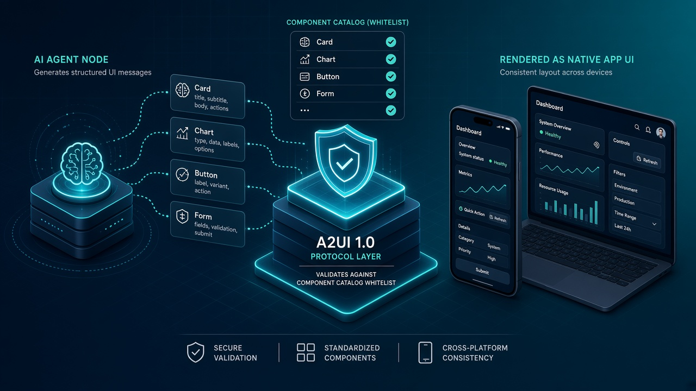
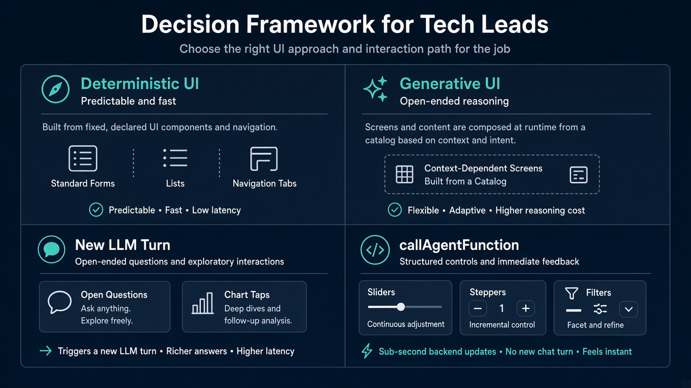
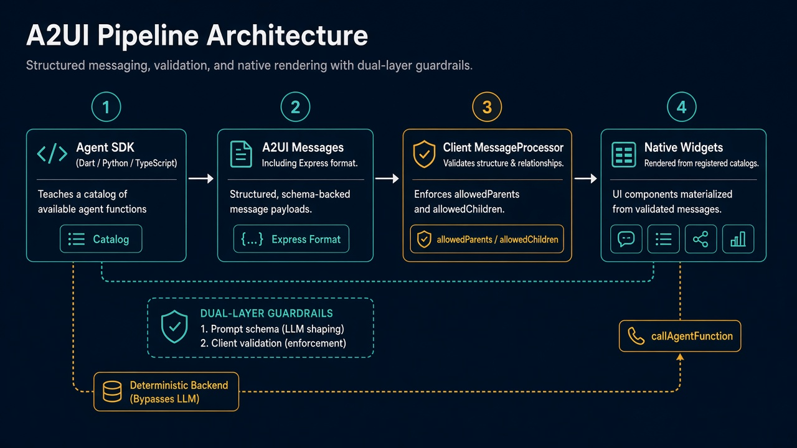

2026 年 11 月,A2UI 协议发布了第一个稳定版 **1.0**。Agent 描述想展示什么,应用用自己的原生组件渲染——不用换 UI 框架,不用重写设计系统。Flutter 官方博客宣布 `a2ui_flutter` 包与协议对齐,Google 开发者博客点名 Atlassian、Alation、Bloomberg、ByteDance 已在生产用 A2UI。([Flutter 博客](https://flutter.dev/blog/a2ui-launch)、[Google Developers 博客](https://developers.googleblog.com/en/a2ui-10-build-delightful-fast-reliable-agentic-experiences/))

但对技术负责人来说,真正要先问清的不是「聊天框里能不能出个图表」,而是:**生成式 UI 该不该进生产客户端、该进哪些画面、目录与校验边界怎么定、哪些交互走 LLM、哪些走硬函数、以及协议 1.0 已稳定但各端渲染器成熟度不一致时怎么选型。** 这些边界不钉死,协议再稳也落不了地。

本文依据截至 **2026-11-18** 的 Flutter 官方博客与 Google 开发者博客解读,**不是**本团队实测,也未在生产 App 里接入 `a2ui_flutter`。我会在文末列出官方链接供核验。



*概念配图:Agent 生成结构化消息,A2UI 1.0 协议层通过组件目录白名单校验,客户端用原生组件渲染,跨设备保持一致体验。*

<!--more-->

## 先别把「协议 1.0」和「各端渲染器成熟度」搅在一起

A2UI 1.0 是**协议的第一个稳定版**,定义了 Agent 与客户端之间怎么传消息、怎么描述组件树、怎么校验层级关系、怎么调后端函数。协议稳定意味着:Agent SDK 生成的消息结构、Express inference format、双层护栏机制(allowedParents / allowedChildren)、多 Catalog 支持、callAgentFunction 双向调用等核心能力已经冻结 API,可以进生产了。

但**渲染器的成熟度不一致**:

| 平台/框架 | 当前状态 | 说明 |
| --- | --- | --- |
| **Flutter** (mobile / web / desktop) | **1.0** (`a2ui_flutter`) | 从 `genui` 更名并对齐协议;官方演示用 Commis 餐饮 App |
| **Web** (React / Angular / Lit) | **1.0** | Google 博客明确支持;也可用于 MCP Apps |
| **SwiftUI** (iOS) | **1.0** | Google 博客列为 1.0 支持 |
| **Jetpack Compose** (Android) | **v0.9.1**,v1.0 **coming soon** | 官方写明「目前是 0.9.1,1.0 即将推出」 |
| **Gemini 托管** | **0.9.1** | Gemini 今天支持 A2UI 0.9.1 |
| **ByteDance Lynx** | **0.9**,正与 A2UI 团队适配 1.0 | 官方说明 |

这意味着:**你选 Flutter/Web/SwiftUI 可以直接上 1.0 协议的全部特性;选 Compose 或要在 Gemini 里渲染,今天还得对齐 0.9 的限制,等升级。** 技术负责人做客户端架构时,必须先分清「协议能力」和「目标平台渲染器版本」,不要把「1.0 已发布」当成「所有端都就绪」。

## 何时用确定性 UI,何时用生成式 UI

官方给了一条非常明确的 rule of thumb (Flutter 博客原文):

> **Generative UI is not intended to replace existing, hardcoded screens in your application.** Standard forms, lists, and navigation tabs already clearly serve workflows and should continue to use deterministic UI. GenUI is suited for scenarios where **the correct interface depends on reasoning about open-ended context.**

翻译过来就是:**标准表单、列表、导航 Tab 已经能清楚承担工作流的,就应该继续用确定性 UI。生成式 UI 适合「正确界面取决于对开放上下文的推理」的场景。**

官方演示用的 Commis 餐饮 App (Flutter 博客演示,非本文实测):用户说「我对贝壳过敏,给我推荐一些菜」,App 基于用户档案、餐厅现有菜单与过敏信息,动态组装出推荐卡片。这种场景下,事先写死的表单无法覆盖所有可能的对话上下文与意图组合,GenUI 才有价值。

再看 Google 博客点名的几个落地案例:

- **Atlassian Jira**:把工作项交给 AI Agent,Agent 需要跟进时用**交互卡片**询问用户(例如「要不要把这个 bug 优先级改成 P0?」)。这是开放上下文推理,不是每次都能提前写好表单。
- **Alation AIOS feed**:用 A2UI 渲染指标卡与图表,同一 feed 可在 Claude 与 Alation 自己的产品里呈现。内容结构依赖数据治理上下文,不是固定导航。
- **Gemini Notebook**:用卡片确认「要不要生成幻灯片/视频概览」的选项。这是对话中间态,写成硬编码表单会割裂流程。

相反,如果你的 App 里已经有「创建订单」「编辑用户资料」「设置通知偏好」这些表单,**它们不应该被 GenUI 替换**——确定性 UI 更快、更可预测、延迟更低,用户也早已习惯那套交互。技术负责人要做的第一个判断是:**先列出 App 里哪些画面属于开放上下文推理,哪些不是。** 只把前者挂上 GenUI。



*决策框架图:左上象限(确定性 UI)适合标准表单/列表/导航;右上象限(生成式 UI)适合开放上下文推理;下半部分区分新 LLM turn(开放问题、深挖)与 callAgentFunction(滑块、过滤器、就地更新)。*

## 架构边界:Catalog 白名单、双层护栏、MessageProcessor

A2UI 1.0 的核心架构约束在于:**Agent SDK 教给模型的是 UI 组件目录(Catalog),客户端在渲染前用 MessageProcessor 强制校验,无效层级会被拦下并通知 Agent。**



*架构流程:Agent SDK 定义组件目录 → A2UI Messages(含 Express format)→ MessageProcessor 校验结构与层级关系 → Native Widgets 渲染;callAgentFunction 可绕过 LLM 直接调后端硬函数。*

注意图中第一框英文写了「teaches a catalog of available agent functions」,但这句**不够精确**——准确说法是 Agent SDK 教给模型的是**UI 组件目录**,不是 Agent 能调的所有函数。目录里定义的是「Card、Chart、Button、Form 这些组件以及它们的 allowedParents / allowedChildren」,不是业务函数清单。

### 双层护栏(Dual-layer guardrails)

Flutter 博客专门强调了这套机制:

1. **Catalog schema 里写明 allowedParents / allowedChildren**:例如官方示例 MyButton 只能被 Row/Column 包裹(allowedParents),只能包 Text/Icon(allowedChildren)。这套规则既会进 Agent prompt(让模型在生成时遵守),也会在客户端建组件前强制校验。
2. **客户端校验失败时**,`a2ui_flutter` 不会崩溃或渲染破损 UI,而是拦下非法层级,返回错误码 `UNALLOWED_PARENT` 或 `UNALLOWED_CHILD`,并通知 Agent 重新生成。

这是一套**双向护栏**:prompt shaping 降低模型犯错概率,client validation 兜底。技术负责人要做的第二个判断是:**谁来定义与维护 Catalog?** 建议答案是:UI 组件库 owner(设计系统团队或客户端架构)负责定义 Catalog、编写 allowedParents/allowedChildren、并与 Agent 开发团队一起测试非法层级的错误处理流程。不要让 Agent 侧自己随便改 Catalog,那会绕过客户端的约束。

### 多 Catalog 支持

A2UI 0.9 时,一个 Surface(画面)只能锁定单一 Catalog;1.0 允许一个 Surface 混用多个 Catalog。Flutter 官方示例:

```dart
MessageProcessor(
  catalogs: [
    CommonCatalog(),
    HealthWidgetsCatalog(),
    CustomChartCatalog()
  ]
)
```

(这是官方示例,非本文实测代码。)

实际落地时,我建议:**按业务域拆 Catalog,而不是全塞一个大目录。** 例如金融 App 可以有 CommonCatalog(按钮、卡片、表单)、ChartCatalog(K 线图、柱状图)、TransactionCatalog(交易确认卡、风险提示)。这样做有两个好处:

1. **权限分层**:某些 Agent session 只给 CommonCatalog,不给 TransactionCatalog,降低误触发交易组件的风险。
2. **变更隔离**:ChartCatalog 升级不影响 CommonCatalog 的稳定性。

但不要拆得太碎——每个 Catalog 都会进 prompt,过多 Catalog 会吃 token 并拖慢推理。

### Extensibility metadata

1.0 还加了可扩展的 metadata,可以挂在 Surface、组件、Catalog 定义和 action 上,用于路由标志、样式提示、安全上下文、correlation token 等。Google 博客提到一个关键用法:**可以在服务端把数据与子组件绑定,从而让敏感值不进入模型。**

但这**不是自动保护**——它是协议/实现设计主张,实际效果取决于你是否按这套约定绑定数据。不要把「A2UI 支持 metadata」写成「用了 A2UI 就自动保证敏感数据不会发给模型」。技术负责人要做的第三个判断是:**哪些字段必须走 metadata 绑定、哪些可以进 prompt,以及绑定失败时怎么降级。**

## 交互边界:新的 LLM turn vs callAgentFunction

A2UI 1.0 区分两种交互路径:

1. **New LLM turn**:用户提出新问题或深挖,触发一轮完整的模型推理,Agent 返回新的组件树。这会产生推理成本(具体资费取决于你选的模型与平台计费,本文不展开),耗时通常在秒级。
2. **callAgentFunction**:已渲染组件可以直接调用 Agent backend 上暴露的**硬函数**,不走 LLM,结果写回现有组件。这是确定性调用,延迟在亚秒级。

Flutter 博客给出的判断标准:

> Clicking a bar in a chart and following a peanut prompt are suited for a new LLM turn. **Sliders, steppers, and filters should not wait seconds for a round trip.**

翻译过来:**点图表柱、跟进提示词适合开新 LLM turn;滑块、stepper、过滤器不应该等数秒往返,应该走 callAgentFunction。**

官方合作伙伴 Somnio Software 的投资伴侣示例(伙伴自述,非本文实测):stepper 调整仓位后,权重/费用/剩余现金**就地更新 in under a second**。这是 callAgentFunction 的典型场景。

另一个合作伙伴 Solid Software 在 GenUI Clinic 原型中称(伙伴自述,非本文实测),换 Express inference format 后,全屏 dashboard 生成从 10 秒降到 5 秒。这是 Express 格式的优化效果,但**不可外推到所有 App**——它只是那个五组件示例在 Flutter 博客中称比压缩 JSON 少 46% 字符的官方说法,不是 Express 一律省 46%。

技术负责人要做的第四个判断是:**列出 App 里哪些交互可以就地调硬函数(滑块、分页、排序、过滤器、stepper),哪些必须走 LLM(开放问题、多轮深挖、复杂推理)。** 前者用 callAgentFunction,后者开新 turn。

但有一点必须钉死:**callAgentFunction 不等于「Agent 不能自主执行」。** 它是协议能力,能调什么函数、是否要审批、函数能不能修改数据,取决于你的 **backend 暴露与权限设计**。不要把协议层的 callAgentFunction 误写成安全保证——那是你自己写的 backend 的事。

## Agent SDK 与跨语言支持

A2UI 协议是语言中立的,Agent 可以用任何语言实现。官方目前提供:

- **Dart**:`a2ui_agent`(新增包)
- **Python**:`a2ui-agent-sdk`、`a2ui-adk`(Google ADK)、`a2ui-a2a`(A2A 协议)
- **TypeScript**:`@a2ui/agent`(Node.js)

任意一种 SDK 都可以驱动同一个 Flutter 应用。全栈 Dart 可以配合 Genkit Dart 框架;`genkit_a2ui` 中间件当前是 **preview**,不是稳定 GA,选型时要算上后续升级成本。

客户端只需要实现一套 `MessageProcessor` + Catalog,Agent 换语言不影响客户端代码。这是协议分层的价值——技术负责人可以让 backend 团队自由选型,客户端只管好 Catalog 与校验。

## 托管与产品边界:MCP Apps 与第三方助手

Google 博客提到:Web 与 Flutter 渲染器还可以用在 **MCP Apps** 里,例如 Claude、Gemini 这类支持 MCP Apps 的助手。这意味着:你写的 A2UI 组件不仅能在自己 App 里渲染,还能出现在第三方助手的对话框里。

Alation 的例子已经验证了这一点:同一个 AIOS feed 可以在 Claude 与 Alation 产品里呈现。

但这带来新的边界判断:**第三方助手里渲染你的 UI 时,目录、数据绑定与审计怎么管?**

1. **Catalog 归谁管**:如果第三方助手自己也有一套组件目录,你的 Agent 是用助手的目录,还是带自己的?建议答案:带自己的 Catalog,但要测试在助手环境里的渲染一致性。
2. **数据绑定与敏感字段**:你的 Agent backend 要知道当前渲染环境是自己 App 还是第三方助手,并据此决定哪些字段可以进 prompt、哪些必须走 metadata 绑定。不要让用户的敏感数据在第三方助手环境里裸奔。
3. **审计与合规**:用户在 Claude 里点了你的交易确认按钮,这个操作的审计日志归谁记、归谁查?建议答案:你的 backend 必须记完整审计(用户 ID、渲染环境、操作时间、结果),不能只依赖第三方助手的日志。

技术负责人要做的第五个判断是:**要不要让 A2UI 组件出现在第三方助手里,以及如果要,Catalog / 数据绑定 / 审计的边界怎么提前定好。**

## 给技术负责人的可执行清单

如果你要评估 A2UI 进生产,建议按以下顺序落地:

### 1. 画面盘点:先挂哪些场景

- 列出 App 里属于「开放上下文推理」的画面(例如智能推荐、多轮对话辅助、动态数据探索)。
- 暂时**不挂**标准表单、固定列表、导航 Tab——它们继续用确定性 UI。
- 选 1-2 个风险可控的画面做 pilot,例如「数据看板的追问与下钻」或「客服对话里的动态卡片」。

### 2. Catalog 归属:谁定义、谁维护

- 由 UI 组件库 owner(设计系统团队或客户端架构)负责定义 Catalog、编写 allowedParents/allowedChildren。
- Agent 开发团队参与测试非法层级的错误处理,但不自己改 Catalog。
- 按业务域拆 Catalog(Common / Chart / Transaction 等),不要全塞一个。

### 3. 校验失败怎么处理

- 客户端拦下 `UNALLOWED_PARENT` / `UNALLOWED_CHILD` 时,不要只 log——要通知 Agent 重新生成,并给用户降级 UI(例如纯文本提示「正在重新生成」)。
- 测试 Agent 收到错误通知后能否正确修正;如果重试多次仍失败,降级到确定性 UI 或人工客服。

### 4. 交互路径:哪些走硬函数

- 列出 App 里的滑块、stepper、过滤器、排序、分页——这些走 callAgentFunction。
- 列出开放问题、多轮深挖、图表柱点击——这些开新 LLM turn。
- 在 backend 明确暴露哪些硬函数可以被 callAgentFunction 调用,并加权限校验与审计。

### 5. 渲染器版本核对

- 如果客户端是 **Flutter / Web / SwiftUI**,可以直接用 A2UI 1.0 全部特性。
- 如果客户端是 **Jetpack Compose**,今天只能对齐 **0.9.1**,等 1.0 就绪后再升级。
- 如果要在 **Gemini 托管**环境里渲染,今天只支持 **0.9.1**。
- 如果用 **ByteDance Lynx**,今天是 **0.9**,正在适配 1.0。

不要把「协议 1.0 已稳定」当成「所有端都能用 1.0」。

### 6. 敏感数据与 metadata 绑定

- 列出哪些字段不能进 prompt(用户身份证号、银行卡号、API token 等)。
- 这些字段必须走 metadata 绑定,在服务端与子组件关联,客户端直接填充。
- 测试绑定失败时的降级逻辑(例如不显示敏感字段,或换成脱敏版)。

### 7. 第三方助手边界(如果需要)

- 决定要不要让 A2UI 组件出现在 Claude / Gemini 等第三方助手里。
- 如果要,backend 必须能识别渲染环境,并据此调整数据绑定与审计。
- 测试在第三方助手里的渲染一致性与交互流程。

### 8. 推理成本与 Express format

- 走 LLM turn 会产生推理成本,具体资费取决于你选的模型与平台计费。
- Express inference format 可以降低 token 消耗,Flutter 博客某个五组件示例称比压缩 JSON 少 46% 字符(但不可外推到所有 App)。
- 测试 Express format 在你的实际组件树下的效果,再决定要不要开。

## 小结

A2UI 1.0 的核心价值在于:**让 Agent 用你已有的设计系统组装界面,而不是重新发明一套 UI 框架。** 协议稳定了,但技术负责人要判断的边界还有很多:哪些画面适合 GenUI、目录与校验归谁管、哪些交互走 LLM、哪些走硬函数、选哪个渲染器时要核对 0.9 vs 1.0 的差异、敏感数据怎么绑定、第三方助手里渲染时边界怎么定。

这些边界不是协议文档能替你回答的——它们取决于你的 App 架构、业务风险、团队分工与合规要求。**协议给了你一套可扩展的约定,但边界还得你自己钉。**

*核验说明:本文主要依据 [Flutter 官方博客](https://flutter.dev/blog/a2ui-launch)(2026-11-17,作者 Andrew Brogdon, Vishal Prabhu Motwani)与 [Google Developers 博客](https://developers.googleblog.com/en/a2ui-10-build-delightful-fast-reliable-agentic-experiences/)(2026-11-11,作者 Vishal Motwani / Google A2UI Team)整理;未在生产 App 里接入 `a2ui_flutter`,未运行本文提及的合作伙伴演示。发布前请以官方文档最新版为准。*
