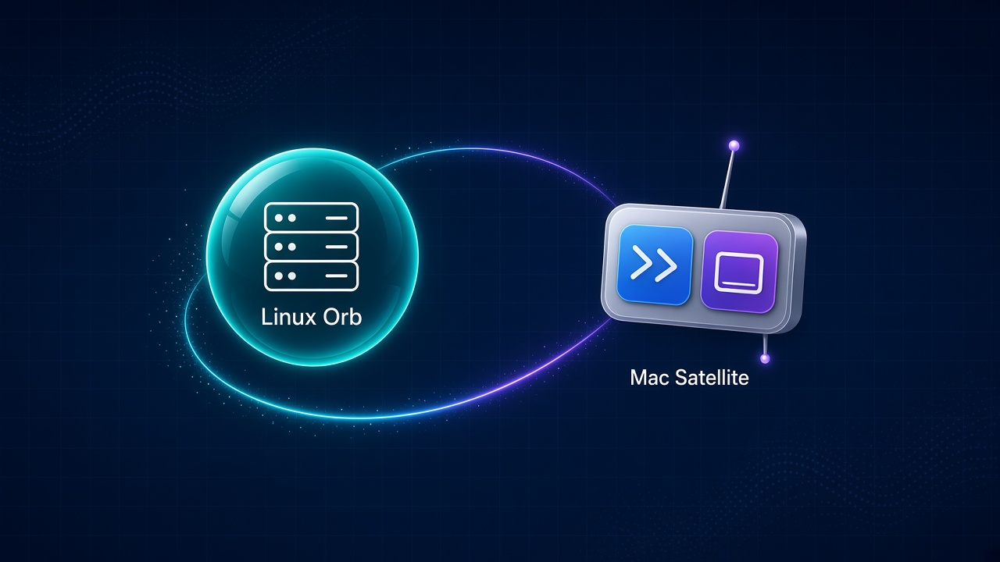
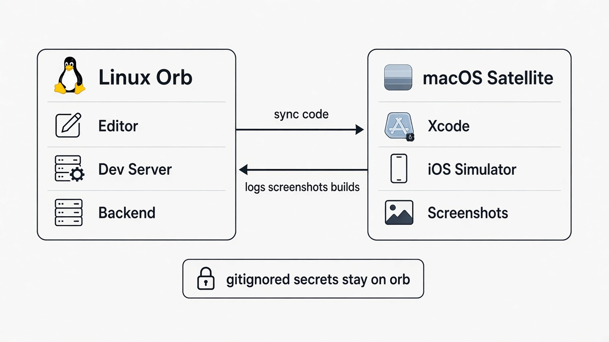
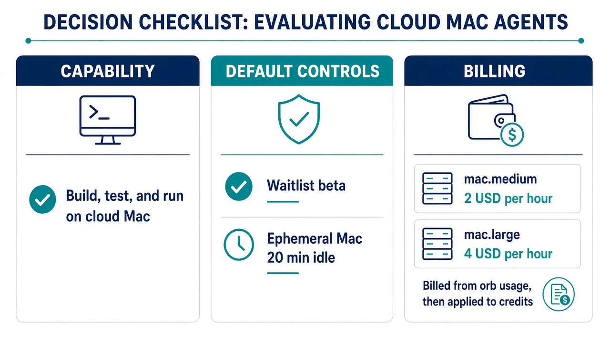

Amp 在 2026 年 10 月 29 日[发布 macOS Satellites](https://ampcode.com/news/macos-satellites)：Agent 线程仍跑在 Linux orb，但现在可以按需启动一台短时云端 Mac，用于 Xcode 构建、iOS 模拟器运行和 GUI 验证。编辑、后端和大部分开发任务留在 Linux，只把必须用 Mac 的工作交给 Satellite。

对 iOS 或 macOS 项目负责人来说，最容易误判的是两件事：以为"按需启动 Mac"等于"Agent 不能自主决策"；以为只要项目包含 iOS 代码，就应该让整个线程常驻在 Mac 上。真正值得评估的是，这套拆分架构能否覆盖团队的构建与验证流程,以及 Satellite 的计费与生命周期是否匹配试点预算。

本文是截至 **2026-11-02** 的[官方文档](https://ampcode.com/docs/orbs/mac)与公告解读，没有加入 waitlist 或运行真实 iOS 构建，也没有本团队的成功率、时延或成本数据。

<!--more-->

## 为什么不让整台云 Mac 跑 Agent

当 Agent 需要访问 macOS 环境时,有两条路径：让整个线程运行在云端 Mac（可称为"Morbs"），或者用 Linux orb 编排、按需调用 Mac 执行面（即 Satellites）。Amp 选择后者,理由集中在启动速度与资源成本。

[官方说明](https://ampcode.com/news/macos-satellites)指出：Docker 与后端服务在 macOS 上启动较慢；为每个线程常驻一台 Mac 的磁盘成本高。因此,将架构拆成 **Linux orb 主编排 + 按需 Mac Satellite**，编辑、后端和非 macOS 工具链仍在 Linux，只在需要构建、运行模拟器或截图时启动 Mac。

这个决策假设 Agent 大部分时间在编辑代码、读文档、运行后端或分析日志，而不是一直操作 Xcode。Quinn Slack 在公开讨论中提到,即使是偏 macOS 的开发,Agent 实际需要 Mac 的时间占比约为 35%。**这是 Quinn 的公开估算，不是团队实测数据或所有 iOS 项目的普遍真理**；但它说明了拆分架构的适用场景：当编辑与调查工作可以在 Linux 完成时,按需 Mac 可以降低常驻成本。

对于必须全程在 macOS 环境调试的场景（例如持续交互式 GUI 测试、需要常驻 macOS 系统服务的工具），这套拆分可能不适用。评估时,应明确哪些任务确实需要 Mac 环境,而不是假设所有客户端开发都必须常驻 Mac。

## Satellite 架构：Linux 主编排 + Mac 按需执行面

下图展示了 Amp macOS Satellites 的工作架构：

[官方文档](https://ampcode.com/docs/orbs/mac)说明，一个使用 Satellite 的 Agent 线程包含两台机器：

| 组件 | 运行环境 | 负责内容 |
| --- | --- | --- |
| Linux orb | 主线程 | 编辑器、开发服务器、后端、Agent 决策逻辑 |
| Mac Satellite | 按需启动 | Xcode、iOS 模拟器、macOS 构建工具、GUI 截图 |

代码在 Mac 执行命令前同步；gitignored 文件（如本地 `.env`）保留在 orb 上。构建产物、日志和截图会回传到 orb。Mac 可以通过 portals 访问 orb 上运行的后端服务，实现前后端联调。用户可在独立的 Mac tab 中观看或接管操作。

Mac 约 30 秒启动，配备 Xcode、模拟器和 Homebrew。它是**全新且不持久化**的：用完后保活 20 分钟以便后续 follow-up 复用构建缓存，之后删除；归档线程或用户要求停止可立即删除。这意味着 Satellite 不能用作需要长期保留状态的环境，也不能假设下一次启动时会继承上一次的系统设置。

### 镜像与 Xcode 版本

当前提供三种镜像（均为 Apple Silicon）：

| 镜像名称 | Xcode 版本 | 模拟器 iOS 版本 | 默认 Xcode |
| --- | --- | --- | --- |
| macos-27 | 26.6, 27.0–27.2 | 27.0–27.2 | 27.2 |
| macos-26 | 见文档 | 见文档 | 见文档 |
| macos-15 | 见文档 | 见文档 | 见文档 |

默认使用 `macos-27`。项目可在 Settings → Satellites 选择镜像；若项目钉了 Xcode 版本（如 `.xcode-version` 文件），系统会自动匹配对应镜像。这避免了手动管理 Xcode 安装，但也意味着需要的 Xcode 版本必须已包含在可用镜像中。

### 生命周期与保活策略

Satellite 的生命周期直接影响构建缓存复用：

1. **按需启动**：Agent 首次需要 Mac 环境时启动，约 30 秒。
2. **执行任务**：运行构建、测试、模拟器或截图。
3. **保活 20 分钟**：任务完成后保持运行，以便后续 follow-up 复用已安装的依赖和构建缓存。
4. **删除**：20 分钟无活动后删除；用户归档线程或要求停止可立即删除。

这个设计适合"修改代码 → 构建 → 验证 → 再修改"的迭代流程，但不适合需要跨多个小时或天级别保留环境的场景。每次新启动的 Mac 都是干净环境，依赖需要重新安装，但 20 分钟窗口内的后续操作可以复用缓存。

## 对 iOS/客户端负责人的决策清单

下图总结了评估 Amp macOS Satellites 时的三个维度：

### 能力边界

| 检查项 | Amp macOS Satellites 当前状态 |
| --- | --- |
| 能否按需启动云端 Mac | 是，约 30 秒启动全新 Mac |
| 代码编辑在哪里 | Linux orb |
| 构建与模拟器在哪里 | Mac Satellite |
| 能否回传截图、日志、构建产物 | 是 |
| 能否访问 orb 上的后端服务 | 是，通过 portals |
| Mac 是否持久化 | 否，ephemeral + 20 分钟保活 |

这些是架构能力，不是权限或审批问题。Agent 可以自主决定何时启动 Satellite，用户可以在 Mac tab 观看或接管。

### 控制面

| 检查项 | 当前设置 |
| --- | --- |
| 谁决定何时启动 Mac | Agent 自主决策 |
| 用户能否观看 Mac 操作 | 可以，独立 Mac tab |
| 用户能否接管 Mac | 可以 |
| 能否关闭 Satellites 功能 | 可以，在 Settings → Experimental Features |
| 访问方式 | Beta waitlist，Settings → Experimental Features；每天 Move Me Up 可提前 |

"按需启动"不等于"每次都需要人工批准"。这是产品设计的权限边界，不是 Agent 模型能力不足。如果团队需要先观察再授权,可以在试点阶段保持 Mac tab 可见,或在 Settings 中暂时关闭 Satellites。

### 计费

[官方计费页面](https://ampcode.com/news/macos-satellites)公布的 Satellite 规格与价格：

| 规格 | CPU | 内存 | 价格 |
| --- | --- | --- | --- |
| mac.medium | 6 CPU | 14 GB | **$2 USD/小时** |
| mac.large | 12 CPU | 28 GB | **$4 USD/小时** |

默认启动 `mac.medium`；Agent 可以要求 `mac.large`，或者用户可在 Settings → Experimental Features 关闭 medium 以强制使用 large。

Satellite 使用时间从计费账号包含的 **orb usage** 额度扣除（按 Satellite 的更高费率），用完后从 **Amp credits** 扣除，扣费逻辑与 orb 相同。这不是独立的 Satellite 套餐,而是统一计费体系的一部分。

试点时,建议分开记录：

1. **Satellite 启动次数与时长**：在 Settings → Usage → Satellites 查看。
2. **实际触发 Satellite 的任务类型**：构建、测试、截图、GUI 验证，分别记录。
3. **orb usage 消耗 vs. credits 消耗**：前者在套餐内,后者是新增账单。
4. **20 分钟保活是否有效复用**：后续 follow-up 是否命中同一 Satellite，避免重复启动。

不要用"每次构建固定多少钱"估算,因为保活复用、并发线程、构建时长都会影响最终费用。也不要假设有"免费 Satellite 额度"，除非官方明确公布具体数字；当前只说明从 orb usage 扣,没有独立免费层。

### 证据回传与验证

Satellite 的价值不仅在于"能构建"，还在于 Agent 能否提交可审查的证据：

| 验证维度 | 要检查的证据 |
| --- | --- |
| 构建成功 | 构建日志、产物路径、是否有警告或失败 |
| 模拟器运行 | 截图、视频、控制台日志 |
| GUI 交互 | 操作步骤、截图序列、预期 vs. 实际行为 |
| 性能或崩溃 | Instruments 数据、crash log |

Agent 应在任务完成后提交这些证据的链接或摘要,而不是只说"构建通过"。审阅者可在 Mac tab 回放或查看回传文件，确认 Agent 的判断是否基于完整信息。

如果 Agent 声称"模拟器显示正常"，但没有提供截图；或者说"性能测试通过"，但没有给出 Instruments 报告，就应要求补充证据。这与普通 PR 审查的标准一致：声明需要证据支持。

## 试点建议：小范围任务、看证据、盯用量

下面是建议方案，不是已完成的实践。

1. **加入 waitlist**：在 Settings → Experimental Features 申请，每天 Move Me Up 可提前。记录申请时间与获批时间。

2. **选择一个有人负责审查的 iOS/macOS 项目**：不要在无人审查的情况下让 Agent 提交生产构建。

3. **从明确、可验证的任务开始**：
   - 修复编译警告，提交构建日志。
   - 为已有功能补回归测试，提交模拟器截图。
   - 验证 UI 布局在不同设备尺寸下的表现，提交多张截图。

4. **每个任务保留一行记录**：

| 字段 | 记录内容 |
| --- | --- |
| 任务描述 | 修复什么、验证什么 |
| Satellite 启动次数 | 本任务触发几次 Mac |
| 总 Satellite 时长 | 从 Settings → Usage → Satellites 读取 |
| 保活复用情况 | 后续 follow-up 是否命中同一 Satellite |
| 提交的证据 | 构建日志、截图、视频链接 |
| 人工审查结果 | 直接接受、补充验证、拒绝，及原因 |
| 新增费用 | orb usage 消耗 vs. credits 消耗 |

5. **审查证据完整性**：
   - Agent 说"构建成功"时，检查日志是否有警告或跳过的测试。
   - Agent 说"UI 正常"时，检查截图是否覆盖关键状态（加载中、错误、空数据）。
   - Agent 说"性能测试通过"时，要求提供具体指标或 Instruments 报告。

6. **监控计费**：在 Settings → Usage → Satellites 查看总用量；在账单页面确认 orb usage 余额与 credits 消耗。如果单个任务触发多次 Satellite 启动,分析是否因为保活窗口已过、任务拆分不当,或者 Agent 判断失误。

7. **触及预算或反复失败时暂停**：如果 Satellite 用量超过试点预算,或者多次提交无效证据、改坏构建配置,就暂停新任务,先分析失败样本。在 Settings → Experimental Features 关闭 Satellites 可停止后续使用,已生成的产物仍应逐个审查。

只有当记录证明 Agent 能提交完整证据、减少人工构建与验证时间、计费在预算内,才值得扩大范围。不能因为"创建了 Satellite"或"提交了截图"就判定成功；成功口径应由独立审查与业务验证决定。

## 边界与未验证声明

本文基于官方文档与公告,说明 Amp macOS Satellites 的架构、生命周期、计费与决策维度,目的是帮助 iOS/macOS 项目负责人判断是否试点、如何记录与审查。

以下内容**未在本文中验证,不应视为已确认事实**：

- 未加入 waitlist,未启动真实 Satellite。
- 未运行 iOS 构建、模拟器测试或 GUI 验证任务。
- 未测量 Satellite 启动时延、构建成功率、证据完整性。
- 未记录实际 orb usage 消耗、credits 账单、保活复用率。
- 未对比"整台 Mac 运行 Agent"与"Linux + Satellite"的总成本。
- Quinn 的 35% 占比是公开估算,不是本团队实测或行业基准。

如果官方文档、计费页面或镜像版本有更新,应以最新版本为准。试点前,再次确认 Settings → Experimental Features 的访问状态、Settings → Usage 的计费明细,以及项目 Settings → Satellites 的镜像配置。

决策时,应基于团队的构建流程、验证标准和预算约束,而不是假设"Agent 需要 Mac"就等于"必须试点 Satellites"。如果团队已有可用的 macOS CI 环境、Agent 的主要工作在后端或 Web,或者试点预算不足以覆盖探索成本,推迟试点也是合理选择。

*核验说明：本文核对了 Amp 官方新闻、文档与公开讨论；架构与计费信息来自官方页面；试点方法属于作者建议。未实际加入 waitlist、未运行真实构建、未测量成功率或成本。发布前应再次确认文档与计费页面是否有变更。*
