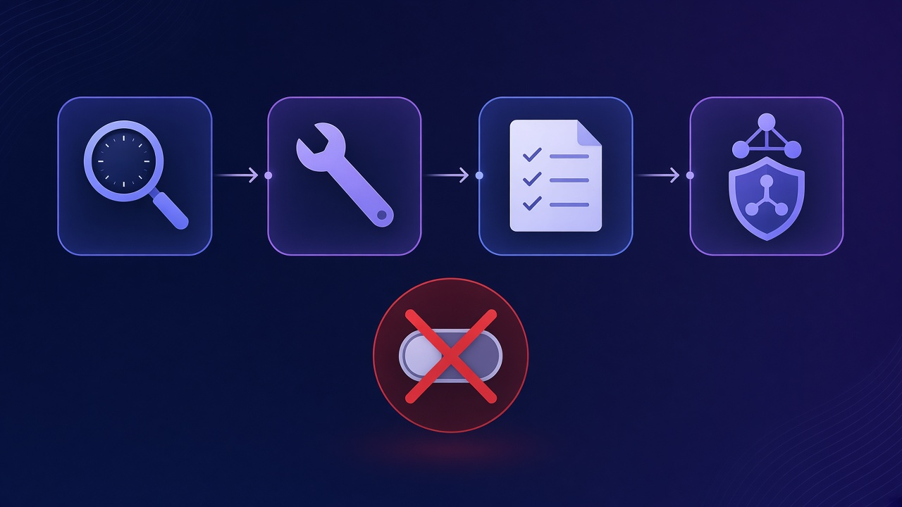
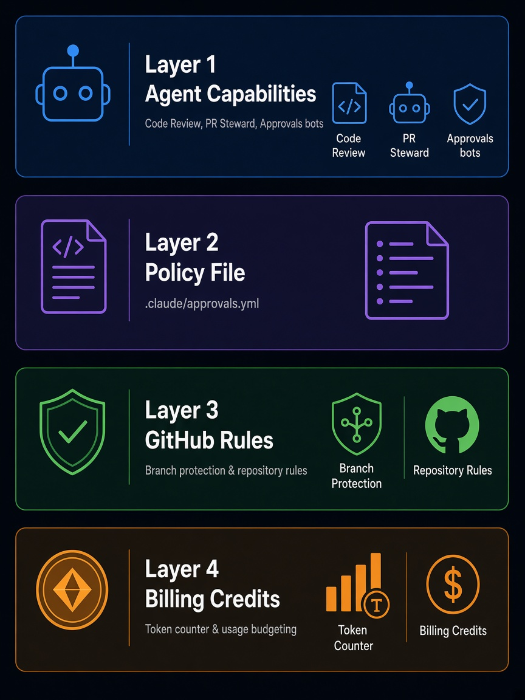
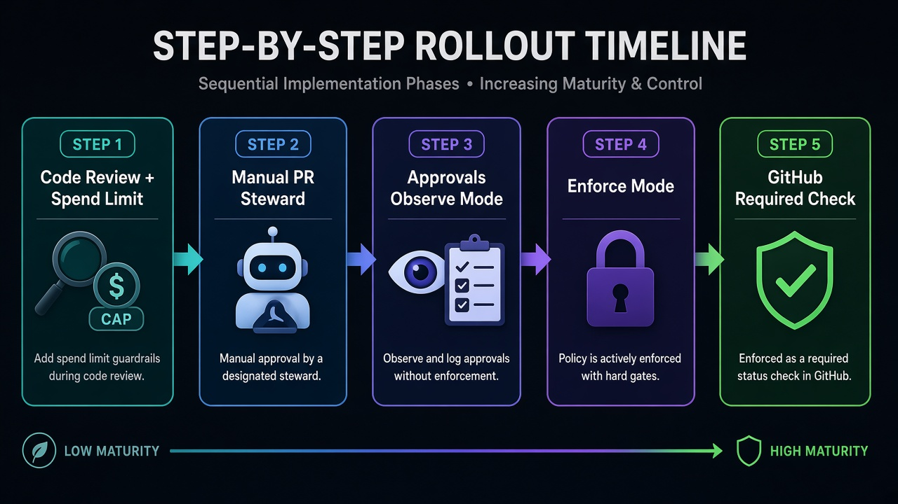

2026 年 11 月 23 日，Anthropic 发布了 **Claude Ship（beta）**。官方说法是：Open a pull request and get back to building. Claude can now **review pull requests, fix them, and approve the ones that a team's policy allows**。团队容易把这句话听成「Claude 会自动合并 PR」，问「我们要不要开 Claude Ship」。**这是错误的决策单元。**

真正要问的是：**Code Review、PR Steward、Claude Approvals 三个 agent 各自能做什么、不能做什么；`.claude/approvals.yml` 策略文件写了什么；GitHub 分支保护规则、required checks、auto-merge、merge queue 怎么配；以及 Team vs Enterprise 的计费与资格差异。** 把这些混在一起，就是把 Agent 能力、仓库策略、GitHub 规则、计费套餐搅成一锅粥，最后上线发现「开了 Claude Ship 还是要我手动批」或者「昨天 PR 没人看就合进 main 了」。

本文依据截至 **2026-11-25** 的 Anthropic 官方公告与文档解读，**不是**本团队实测。我会在文末列出官方链接供核验。



*概念配图：Claude Ship 通过审查→修复→审批政策→GitHub 规则 决定能否合并，而不是一个「自动合并」开关；图中红叉表示这不是你想象的那个开关。*

<!--more-->

## 先拆清四层：Agent 能力、策略文件、GitHub 规则、计费不能混为一谈

技术负责人选型时最常见的错误，是把 **Agent 能力边界**、**仓库策略文件**、**GitHub 分支保护规则**、**计费与套餐资格** 当成一回事。Claude Ship 这次发布让这个问题更明显：同一个「Claude 能批准 PR」既是 Agent 能力（Claude Approvals 可以 post approving review），也取决于策略文件（`.claude/approvals.yml` 写不写 `claude: approves`），也取决于 GitHub 规则（分支保护是否只要求一个 approval、Claude Approvals check 是否 required），还取决于计费（Approvals 的 classifier 会按 token 计费、策略文件一上默认分支就可以开始计费）。



*分层示意：选型时把 Agent 能力、策略文件、GitHub 规则、计费套餐分成四层看，同一个「Claude 能批准」可以同时出现在不同层。*

### 第一层：Agent 能力边界（官方设计目标，不是我们的实测结论）

从官方博客与文档的定位看（[公告](https://claude.com/resources/articles/introducing-claude-ship)、[文档总览](https://code.claude.com/docs/en/claude-ship)）：

- **Code Review（已 GA）**：对照代码库做深入审查，multiple lenses，adversarially verifies findings，分类后发到 PR。每仓库可选 **Quick、Standard、Deep** 三档。Findings ranked **Important、Nit、或 Pre-existing**。可用 `REVIEW.md` 调整勾什么。官方给出的 Claude Code 团队自身数据（**必须标明是「Claude Code 团队、且 Claude 的审查只是更广流程中的一层」，不是通用客户效果，也不是我们实测**）：merged PRs more than doubled from June to September while the share reverted fell by more than 40%。

- **PR Steward（beta）**：让 PR 变绿——处理失败的 CI、merge conflicts、来自 Code Review / 其他审查工具 / 团队成员的反馈。**设计目标是不 approve、不 merge pull requests**（官方原话：**PR Steward is designed to leave approving and merging to your team**）。文档明确写：**Use branch protection to require the approvals you want**。每次 push 后评论改了什么、如何 undo。开发者可用 `@claude` 指示，或 `@claude stop` 让它停下。在云端工作，不必等开发者回来。官方建议启用顺序：先 **Manual**（`@claude steward` / 产品页写 Start in Manual mode），团队信任后再默认开启。**PR Steward has no spend limit of its own until you set one。**

- **Claude Approvals（public beta）**：是 GitHub 上的一个 **check**，报告还缺谁批准。策略文件是仓库根目录**默认分支**上的 **`.claude/approvals.yml`**。文件一上默认分支，Approvals 就可以开始计费。策略可设置某路径需要多少人批准、Claude 可否批准、是否用 classifier / 自然语言条件。官方比喻：**like a smarter CODEOWNERS**。

**重点在于**：PR Steward 不是「合并 agent」，它是「修复 agent」。Claude Approvals 是「批准决策 check」，不是「自动批准机器人」——能不能批、批不批，取决于策略文件怎么写。

### 第二层：策略文件 ≠ Agent 能力

`.claude/approvals.yml` 是策略文件，不是 Agent 自己的能力。官方文档给了一个示例（可引用，不要改写成不存在的字段）：

```yaml
# .claude/approvals.yml
version: 1
mode: observe
rules:
  - purpose: "A change takes two people, and Claude doesn't approve."
    paths: ["**"]
    verdict: { claude: comments, seats: 2 }
    advisory: [claude/code_review]
```

关键字段：

- **`mode: observe`**：先看策略会如何裁决，通常 check 算通过，不阻断合并。官方对大多数客户建议**先 observe-only**，建立信心后再把 Claude Approvals 设为 required check，并 **enforce** 策略。
- **`verdict: { claude: comments, seats: 2 }`**：Claude 只 comments，不批准；需要两个人（author 可以占一个 seat）。
- **`advisory: [claude/code_review]`**：在这条规则覆盖的改动上跑 Code Review。

**官方还有两个 starter 策略**（必须写对语义，不要编第三套官方模板）：

**A) Let Claude approve when Code Review passes**：Code Review 通过后通常只需 author，但对 `.claude/` 下的改动仍要两个人。

**B) Keep two people on each change**：通常还要 author 之外的一个人，Claude 只 comments。

**重点**：策略文件不在，Claude Approvals 不运行；策略文件在，但 `claude: comments`，Claude 就不批准。不要把「策略默认不批准」写成「Claude Approvals 不能批准」。

### 第三层：GitHub 规则 ≠ 策略文件

即使策略文件写了 `claude: approves`，能不能真的让 PR 合并，还取决于 **GitHub 分支保护规则、required checks、auto-merge、merge queue**。官方文档总览有一句非常明确的话：**Your settings and GitHub branch rules determine what merges.**

官方还明确警告 **「Merges without human review」**（文档总览与产品 FAQ 都有），我必须单独写清楚，且逐条对齐文档，不要发挥：

1. **check 不是 required**：Claude Approvals 只有在你把它设为 GitHub required check 时才阻断合并，而且 observe mode 下通常不阻断。
2. **策略不再要其他人**：author 可以占一个 seat；`seats: 1` 时可以没有第二个人看；`seats: 0` 时，机器人开的 PR 可以在没有人看过的情况下合并。
3. **GitHub 把 Claude 的批准算进去**：若 GitHub 分支规则只要求一个 approval，Claude 的 approving review 可以成为那一个 approval。
4. **`claude: approves` 本身不会启动 Code Review**，所以 Claude 可能批准一个谁都没审查过的改动。若要先审查，应让 Claude 只在 Code Review 通过时批准。
5. **文档总览还有一句**：**If you use GitHub auto-merge or a merge queue with a policy that doesn't require a person's approval, a change can merge without anyone acting.**

**也就是说**：如果你的 GitHub 分支保护只要求一个 approval，策略文件写了 `claude: approves`，GitHub 把 Claude 的 approving review 算作那一个 approval，并且你开了 GitHub auto-merge，那么 PR 可以在没有人看过的情况下合并。这不是 Claude Ship 的「能力问题」，而是你的 **GitHub 规则 + 策略文件 + auto-merge 配置组合出来的风险**。

### 第四层：套餐、资格与计费（必须用官方最新页，不要混用过时口径）

#### 资格

- **Team 和 Enterprise**，面向 GitHub 上的仓库（文档写 **works on github.com, including GitHub Enterprise Cloud**）。
- **不可用**：Zero Data Retention、HIPAA configuration、customer-managed encryption keys (CMEK)。
- **Approvals 额外限制**（文档）：**Can't start Approvals with FERPA or Access Transparency settings**。
- 文档还写：**A private repository also needs a paid GitHub plan**（才能把 Claude Approvals check 设为 required）。写的时候要跟「Claude 计划」分开，不要混成同一个付费条件。

#### 计费（必须严格按官方，禁止编单价或套餐对照表）

官方说法（公告 + 产品 FAQ + 文档，我已再核对 2026-11-25）：

- **Claude Ship usage is billed on tokens**，打开后会增加组织成本。金额取决于覆盖的 PR 数量和大小、review level、审查运行频率、PR Steward 做了多少工作。
- 各 agent 通过组织的 **usage credits** 按 token 计费，**separate from your plan's included usage**。
- **Admins can set spend limits for Code Review and PR Steward**。
- **Claude Approvals has no base charge**，但 classifiers in a policy are billed on the tokens they use，and **a policy that uses Claude's review triggers a billed Code Review, even in observe mode**。
- **Running `/ship` counts as regular Claude Code usage**。
- 若在 Organization settings > Usage 关闭 usage credits，已经打开的 agent 仍会继续运行并计费；要停费必须按文档关掉 Claude Ship agents。
- 公告促销（写时必须带「Eligible」「Terms apply」，并指向官方公告，不要写成所有客户都有）：**Eligible Claude Enterprise organizations can claim at least $10,000 in Claude Ship credits to use within 30 days of claiming. Claim by January 15, 2027. Terms apply.**
- 文档只说 **Eligible Enterprise organizations can claim promotional Claude Ship credits**，细节见 credit terms。不要编谁合格、精确额度或隐藏条款。若你能找到官方 credit terms 页面就链过去；找不到就只引用公告这句话，并注明以官方条款为准。
- **不要捏造每百万 token 单价、各 review level 的固定价格、或「Team vs Enterprise 功能对照表」（官方若只有文字资格说明，就保持文字，不要做成你发明的表格）。**

## 三个 agent 各做什么、明确 Steward 不负责批准和合并

### Code Review：找问题

Code Review reads a change alongside the surrounding code. Findings arrive as inline comments on the lines concerned, ranked by severity.

每仓库可选 Quick、Standard、Deep。Findings ranked Important、Nit、或 Pre-existing。可用 `REVIEW.md` 调整勾什么。

### PR Steward：推修复

PR Steward works on failing checks, merge conflicts, and review comments from people and from review bots such as Code Review. It pushes commits with its fixes.

**Steward is designed not to approve or merge pull requests.** 文档明确写：**Use branch protection to require the approvals you want before anything merges.** 还有一句：**See Limits on approvals and merges**。

产品页：**PR Steward is designed to leave approving and merging to your team.**

**也就是说**：官方设计目标是让 Steward 只负责修复，不负责批准和合并。如果你的 PR 最后被 Steward 合并了，那是因为你的 GitHub 规则 + 策略文件 + auto-merge 配置允许了这件事，不是 Steward 自己的能力。

### Claude Approvals：应用策略

Claude Approvals is a check that reports who still has to approve. 策略文件是仓库根目录默认分支上的 `.claude/approvals.yml`。

**The check blocks a merge only where you make it a required check in GitHub, and normally not in observe mode.**

官方原话：**If you use GitHub auto-merge or a merge queue with a policy that doesn't require a person's approval, a change can merge without anyone acting.**

## 组织级 Claude Ship vs 个人 `/ship`、`/steward`，不要混

官方文档有两个入口：

### For admins and engineering leaders: 组织级 Claude Ship

Turning Claude Ship on for an entire repository puts it to work across a team's pull requests automatically, under settings and an approval policy the team controls. Developers don't need to manually invoke the `/ship` command.

- Admins choose where it runs. An admin turns on Code Review and PR Steward for each repository. Claude Approvals starts when a connected repository has a policy file on its default branch, and an admin can turn it off.
- Each repository gets the settings it needs. Admins choose the review level (Quick, Standard, or Deep), choose when reviews run, and configure spend limits.
- Teams keep the tools they have. Claude Ship works with existing branch protection and required checks.

### For developers: `/ship` 与 `/steward` 命令

文档：**To get a review and fixes locally, on one of your own pull requests, run `/ship` in Claude Code.**

- **`/ship`**：若还没有 PR 就打开 GitHub PR，审查改动，处理反馈和失败检查，帮 PR 准备到可合并。官方反复写：**What can merge depends on the developer's permissions and the repository's branch rules.**
- 公告：**`/ship` is rolling out in Claude Code and the desktop app starting today（2026-11-23）**。
- **`/steward`**：在已打开的 PR 上跳过先审、直接开始 watch。文档明确：**`/steward` is separate from PR Steward, the agent that an organization sets up. Where PR Steward is already working on your pull request, no watch starts.**
- **`/ship` 的 watch 使用开发者自己的 `gh` 和 `git` 登录，GitHub 上的操作出现在开发者名下。** 这是权限/身份问题，不要写成「组织级 Steward 会用开发者身份合并」。
- **不要把 auto mode 下列出的「Merges the base branch into yours」写成「自动合并 PR」。** 那是把 base 合进功能分支以解决冲突或跟上 main，不是 merge the pull request。写之前请再打开 [/ship 文档](https://code.claude.com/docs/en/ship-command) 核对原文。
- **`/ship` 在 draft PR、其他 base branch、要用仓库 PR 模板、GitHub Enterprise 或 fork 上的 PR 等情况下，文档要求先自己开 PR 再运行 `/ship`。** v2.1.331 前后对「提交在默认分支」时是否自动建分支的行为有差别，若要写，必须核对 ship-command 文档，写不准就省略，不要猜版本号行为。

**重点**：组织级 Claude Ship 是给整个仓库开的 agents，按 organization usage credits 计费；`/ship` 和 `/steward` 是个人在 Claude Code 里跑的命令，按 regular Claude Code usage 计费。两者不是同一个东西，不要混。

## 审批策略与「无人审阅也可能合并」的官方警告

### 策略文件什么时候生效

官方步骤：策略文件单独开一个 PR；等 Claude 评论 **found the policy file in this change valid** 再合并；然后再开一个非 draft、合入默认分支的 PR，才能看到标题以 **(observe mode)** 开头的 check。

文件一上默认分支，Approvals 就可以开始计费。

### 谁能打开

只要有人能把策略文件 merge 进默认分支，Approvals 就可以被打开。**Claude 组织 Owner 可以在组织级关掉，关掉后即使再 merge 策略文件也保持关闭。**

### observe vs enforce

- **`mode: observe`**：先看策略会如何裁决，通常 check 算通过，不阻断合并。
- 从 observe 切到 enforce 时：先决定哪些文件无论 Claude 怎么判断都要人批、check 要卡住哪些分支、以及何时改 GitHub required approvals 数量——官方写明：**change the number of approvals that GitHub requires only after the last step of the switch**。

### 检查标题例子

- **Waiting on human review from any person (1/2)**
- 以 **(observe mode)** 开头表示当时未强制执行。

### github.com 上由 Claude GitHub App 报告 check 时，批准来自 `claude[bot]`；若 PR 是 `claude[bot]` 开的，批准来自 `claude-approvals[bot]`（需安装 Claude Approvals GitHub App）

不要把两个 bot 混为一谈。写到这一层即可，不要编安装点击路径。

### 官方明确警告「Merges without human review」

我已经在第三层写过，这里再强调一遍：

1. check 不是 required：Claude Approvals 只有在你把它设为 GitHub required check 时才阻断合并，而且 observe mode 下通常不阻断。
2. 策略不再要其他人：author 可以占一个 seat；`seats: 1` 时可以没有第二个人看；`seats: 0` 时，机器人开的 PR 可以在没有人看过的情况下合并。
3. GitHub 把 Claude 的批准算进去：若 GitHub 分支规则只要求一个 approval，Claude 的 approving review 可以成为那一个 approval。
4. `claude: approves` 本身不会启动 Code Review，所以 Claude 可能批准一个谁都没审查过的改动。若要先审查，应让 Claude 只在 Code Review 通过时批准。
5. 文档总览还有一句：If you use GitHub auto-merge or a merge queue with a policy that doesn't require a person's approval, a change can merge without anyone acting.

**也就是说**：团队容易把「Claude 能审查、修复、审批」听成「Claude 会自动合并」。这是错误的决策单元。要拆开四层：Agent 能力边界、策略文件、GitHub 规则、计费与资格，才能定清楚哪些 PR 需要人批、哪些可以让 Claude 批。

### 加入策略文件可能改变自动 Code Review

一旦默认分支有策略文件（observe 或 enforced），若 PR 改动的文件都落在策略覆盖范围内，且没有规则写 `claude/code_review`，自动审查通常会停。要保留自动审查，就在规则里写上 `claude/code_review`（示例放在 `advisory`）。

### 启用前官方要求

强制执行页上任一 starter 策略前，需要**两名有 write access 的人**，因为两条策略都要求 `.claude/`（含策略文件本身）的改动要两个人。

## 推荐落地顺序：一个仓库、先 Code Review 并设花费上限、Steward 先 Manual、Approvals 先 observe，最后才 required check + enforce



*落地顺序：先 Code Review 并设花费上限，再 Manual PR Steward，再 Approvals observe，最后才 enforce + required check；关掉顺序相反。*

### 官方建议启用顺序（文档）

Turn on one agent at a time in one repository, in this order:

1. **Set up Code Review**
2. **Set up PR Steward**. For the setting that chooses when PR Steward starts, begin with **Manual** (`@claude steward`). PR Steward has no spend limit of its own until you set one.
3. **Set up Claude Approvals**. A policy file in the repository starts it, so see who can turn it on. Start in **observe mode**, where the Claude Approvals check reports what your policy would decide. Observe mode is billed. See what Approvals costs.

### 如果你已经用 Code Review

Code Review's settings moved to Organization settings > Claude Ship.

A Claude Approvals policy file, `.claude/approvals.yml`, changes which pull requests Code Review reviews automatically. Once the file is on the default branch, in observe mode or enforced, automatic reviews normally stop where no matching rule names `claude/code_review`. To keep them, add `claude/code_review` to a rule.

### 关掉顺序

Turn off Approvals before Code Review, because a policy can start billed reviews where Code Review is off:

1. Turn off Approvals
2. Turn off PR Steward
3. Turn off Code Review

These steps leave the `/ship` and `/steward` commands on. See how to turn them off.

### 实际可执行步骤（基于官方建议，我加工为可执行清单）

#### 1. 选一个仓库 pilot

- 不要一上来就全组织开。选一个风险可控、PR 频率适中的仓库。
- 团队至少要有两名有 write access 的人（启用策略文件时需要）。

#### 2. 先 Code Review，设花费上限

- 在 Organization settings > Claude Ship 里打开 Code Review，选 **Quick** 或 **Standard**（不要一上来就 Deep，Deep 最贵）。
- **设月度花费上限**（spend limit）——这是官方强烈建议的，不要跳过。
- 跑一周，看平均每 PR 成本、看 findings 质量、看 Important vs Nit 比例。
- 如果 findings 大多数是 Pre-existing（已经存在的问题），考虑调整 `REVIEW.md` 或换 review level。

#### 3. 加 PR Steward，先 Manual

- 打开 PR Steward，把启动设置选成 **Manual**（开发者评论 `@claude steward` 才启动）。
- **设花费上限**（Steward has no spend limit of its own until you set one）。
- 团队试用一周，看 Steward 推的修复是否符合预期、是否有误修、是否有不必要的 push。
- 如果信任了，再改成默认开启。

#### 4. 加 Approvals，先 observe

- 写策略文件 `.claude/approvals.yml`，单独开一个 PR。
- 等 Claude 评论 **found the policy file in this change valid** 再合并。
- 合并后，再开一个非 draft、合入默认分支的 PR，看到标题以 **(observe mode)** 开头的 check。
- **不要立刻 enforce**——先 observe 一周，看策略裁决是否符合团队预期。
- **检查 observe mode 的计费**——classifier 会按 token 计费，策略用了 Claude's review 也会触发 Code Review 计费。

#### 5. 最后才 enforce + required check

- 从 observe 切到 enforce 时：
  - 先决定哪些文件无论 Claude 怎么判断都要人批。
  - 决定 check 要卡住哪些分支（通常是 `main` / `master`）。
  - **最后一步**才改 GitHub required approvals 数量（官方写明：change the number of approvals that GitHub requires only after the last step of the switch）。
- 把 Claude Approvals check 设为 GitHub required check（在 GitHub 分支保护里）。
- 策略文件 `mode` 改成 `enforce`，再开一个 PR 合进去。

#### 6. 关掉时顺序相反

- 先关 Approvals（从策略文件删掉，或在组织级关掉）。
- 再关 PR Steward。
- 最后关 Code Review。
- 这个顺序是因为策略文件可能在 Code Review 已关时仍触发计费审查。

## 技术负责人可执行的边界清单

如果你要评估 Claude Ship 进生产，建议按以下顺序落地：

### 1. 先确认资格与计费

- 检查组织是不是 **Team 或 Enterprise**（Claude Ship 不支持 Free / Pro）。
- 检查是否开了 **Zero Data Retention、HIPAA、CMEK、FERPA、Access Transparency**——有这些就不能用 Claude Ship（Approvals 有额外限制）。
- 检查仓库是不是在 **github.com**（含 GitHub Enterprise Cloud）——其他托管平台（GitLab / Bitbucket / Azure DevOps）的 `/ship` watch 有限制，组织级 Claude Ship agents 目前不支持。
- 若仓库是 private，检查是否有 **paid GitHub plan**（才能把 Claude Approvals check 设为 required）。
- **Enterprise 组织可以申请促销 credits**（至少 $10,000，30 天内用完，2027-01-15 前申请，条款另行）——别错过这个，但别把促销额度当成稳态成本。

### 2. 选一个仓库 pilot，设花费上限

- 不要一上来就全组织开。选一个风险可控、PR 频率适中的仓库。
- **先开 Code Review，选 Quick 或 Standard，设月度花费上限。**
- 跑一周，看平均每 PR 成本、findings 质量、Important vs Nit 比例。

### 3. GitHub 规则盘点：分支保护、required checks、auto-merge、merge queue

- 列出目标仓库的 **分支保护规则**：哪些分支受保护、要求几个 approvals、是否要求 code owner approval。
- 列出 **required checks**：哪些 CI check 是 required、是否允许 dismiss stale reviews。
- 检查是否有人开了 **GitHub auto-merge** 或 **merge queue**——有这些的话，Claude Approvals check 通过后可能自动合并。
- **决定你的边界**：哪些 PR 可以让 Claude 批、哪些必须要人批、哪些必须要 code owner 批。

### 4. 策略文件边界：谁能批、谁必须批、Claude 能批哪些

- 写 `.claude/approvals.yml` 策略文件前，先列出：
  - 哪些路径必须要人批（例如 `.claude/`、`deploy/`、`infra/`、`security/`）。
  - 哪些路径可以让 Claude 批（例如 `docs/`、`tests/`、`README.md`）。
  - `seats` 设几个（`seats: 2` 表示要两个人，author 可以占一个；`seats: 1` 表示只要一个人，可能是 author；`seats: 0` 表示机器人 PR 可以没人看）。
  - `claude: approves` 还是 `claude: comments`（approves 表示 Claude 可以批；comments 表示 Claude 只评论，不批）。
  - 是否用 `advisory: [claude/code_review]`（用了会先跑 Code Review，会计费）。
- **官方两个 starter 策略**：
  - **A) Let Claude approve when Code Review passes**：Code Review 通过后通常只需 author，但对 `.claude/` 下的改动仍要两个人。
  - **B) Keep two people on each change**：通常还要 author 之外的一个人，Claude 只 comments。
- 选一个，或自己写（但别从 observe 直接跳 enforce，先 observe 一周）。

### 5. PR Steward 边界：先 Manual，信任后再默认

- 打开 PR Steward，把启动设置选成 **Manual**（`@claude steward`）。
- **设花费上限**（Steward has no spend limit of its own until you set one）。
- 团队试用一周，看 Steward 推的修复是否符合预期、是否有误修、是否有不必要的 push。
- 如果信任了，再改成默认开启。
- **明确告诉团队**：Steward 不负责批准和合并，它只负责修复。要批准和合并，要么人批，要么策略文件 + GitHub 规则允许。

### 6. Approvals 边界：先 observe，最后才 enforce + required check

- 策略文件单独开一个 PR，等 Claude 评论 valid 再合并。
- 合并后，再开一个 PR 看 observe mode 的 check。
- **不要立刻 enforce**——先 observe 一周，看策略裁决是否符合团队预期。
- **检查 observe mode 的计费**——classifier 会按 token 计费，策略用了 Claude's review 也会触发 Code Review 计费。
- 从 observe 切到 enforce 时：
  - 先决定哪些文件无论 Claude 怎么判断都要人批。
  - 决定 check 要卡住哪些分支（通常是 `main` / `master`）。
  - **最后一步**才改 GitHub required approvals 数量。
- 把 Claude Approvals check 设为 GitHub required check。

### 7. 明确警告团队：这些组合可能导致无人审阅也能合并

告诉团队（尤其是有 admin 权限的人）：

1. 如果 GitHub 分支保护只要求一个 approval，策略文件写了 `claude: approves`，GitHub 把 Claude 的 approving review 算作那一个 approval，并且你开了 GitHub auto-merge，那么 PR 可以在没有人看过的情况下合并。
2. 如果策略文件 `seats: 0`，机器人开的 PR 可以没人看就合并。
3. 如果策略文件 `claude: approves` 但没写 `advisory: [claude/code_review]`，Claude 可能批准一个谁都没审查过的改动。
4. 如果 Claude Approvals check 不是 required，策略文件即使 enforce 也不会阻断合并。
5. 如果你用 GitHub merge queue，策略不再要人批，queue 可能自动合。

**这些不是 bug，是你的配置组合。** 要避免，就在策略文件、GitHub 规则、auto-merge 三个地方都检查。

### 8. 组织级 Claude Ship vs 个人 `/ship`、`/steward`，明确计费差异

- 组织级 Claude Ship（Code Review / PR Steward / Claude Approvals）按 **organization usage credits** 计费，从组织账户扣。
- 个人 `/ship` 和 `/steward` 按 **regular Claude Code usage** 计费，从个人或组织的 Claude Code 用量扣。
- 两者不是同一个东西，不要混。
- **`/ship` 的 watch 使用开发者自己的 `gh` 和 `git` 登录，GitHub 上的操作出现在开发者名下。** 不要把这个写成「组织级 Steward 会用开发者身份合并」。

### 9. 关掉时顺序相反：先 Approvals，再 Steward，最后 Code Review

- 若要关掉，顺序相反：先关 Approvals，再关 PR Steward，最后关 Code Review。
- 这个顺序是因为策略文件可能在 Code Review 已关时仍触发计费审查。
- 关掉组织级 agents 后，`/ship` 和 `/steward` 命令仍在，要另关（在 managed settings 里加 `skillOverrides` 或设 `CLAUDE_CODE_DISABLE_SHIP=1`）。

## 小结

Claude Ship 的核心价值在于：**让 Claude 在 PR 打开后自动审查、修复、并按策略决定批准，而不是让开发者停下来手动处理每一条反馈。** 但技术负责人要判断的不是「要不要开 Claude Ship」，而是 **Code Review、PR Steward、Claude Approvals 三个 agent 各自能做什么、策略文件怎么写、GitHub 规则怎么配、以及计费与资格是否匹配**。

把这些混在一起，就是把 Agent 能力、策略文件、GitHub 规则、计费套餐搅成一锅粥，最后上线发现「开了 Claude Ship 还是要我手动批」或者「昨天 PR 没人看就合进 main 了」。**官方反复强调：Your settings and GitHub branch rules determine what merges.** 这不是一个「自动合并」开关，而是一套可配置的审查→修复→审批政策系统。

**边界还得你自己钉。**

## 核验链接（发布前请再次确认）

以下链接核对日期：**2026-11-25**

1. [Introducing Claude Ship（官方公告，2026-11-23）](https://claude.com/resources/articles/introducing-claude-ship)
2. [Claude Ship 产品页](https://claude.com/product/claude-ship)
3. [Claude Ship 文档总览](https://code.claude.com/docs/en/claude-ship)
4. [Get a pull request ready with /ship and /steward](https://code.claude.com/docs/en/ship-command)

---

**孙升隆（SSLoong）**，devloong.com，技术负责人。本文依据截至 2026-11-25 的官方公告与文档解读，不是本团队实测。如官方页与本文有出入，以官方最新页为准。
