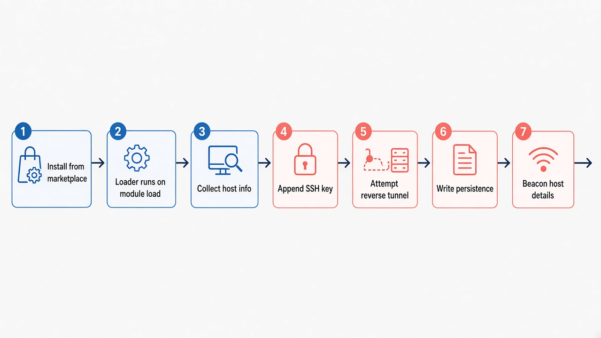
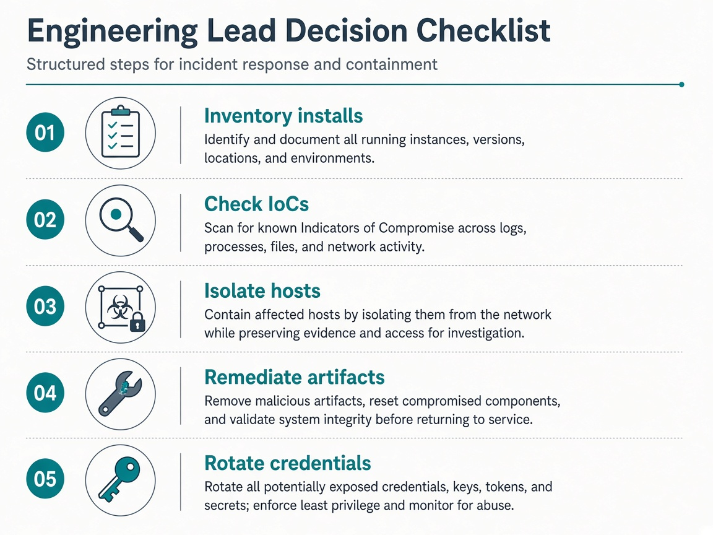

2026 年 10 月 29 日，Cursor 官方确认：其 VS Code Extension Marketplace 上出现过被篡改的 `Anthropic.claude-code` **2.1.312 / 2.1.313**（Windows 与 macOS）。包在合法扩展身份下分发，模块加载时注入恶意 loader，尝试写入 SSH 后门与持久化。[Cursor 安全通告](https://cursor.com/blog/claude-code-extension-security-notice)

对技术负责人来说，真正要先分清的不是「Claude 模型坏了吗」，而是：**这是哪一层被打穿了**——模型能力、Agent 工具权限、还是 IDE 扩展的分发渠道。答案是第三层：Cursor 自家 Marketplace 的分发链路。

本文依据截至 **2026-11-04** 的 Cursor 通告、Microsoft Security 分析与公开报道整理，**不是**本团队的取证报告，也没有本机实测恶意样本。


*概念配图：扩展从市场到开发机的信任链，以及安装侧需要持续校验的环节。*

<!--more-->

## 先把边界钉死：什么中招，什么没中

| 维度 | 结论 | 依据 |
| --- | --- | --- |
| 受影响渠道 | **仅** Cursor VS Code Extension Marketplace | Cursor / Microsoft |
| 受影响版本 | `anthropic.claude-code` **2.1.312、2.1.313**（Win / macOS） | Cursor 通告（10-30 更新补全 2.1.312） |
| 暴露窗口 | 约 2026-10-29 **2:27am–1:35pm PT**（约 11 小时） | Cursor |
| 规模上限 | Cursor 称至多约 **5000** 名在该窗口安装/更新的用户 | Cursor / 媒体转述 |
| Anthropic 官方系统 | **未**被攻破；恶意包不是 Anthropic 发布的 | Anthropic 对外说明；Microsoft 确认 |
| Microsoft VS Marketplace | **未**发现该恶意包 | Microsoft |
| Open VSX / npm `@anthropic-ai/claude-code` | **未**发现该恶意版本进入公开分发 | Microsoft / Socket 等公开复核 |
| 其他 Cursor Marketplace 扩展 | Cursor 审计后称**无证据**显示另有扩展被篡改 | Cursor |

把「Cursor Marketplace 被投毒」写成「Claude Code 全渠道失陷」或「Anthropic 被黑」，都是事实分层错误。同理，这与 Claude / Cursor Agent 的**默认权限与审批模式**、与**计费套餐**无关——不要混进选型对比里。

安全版本侧：公开信息显示 Anthropic 随后在官方渠道上架 **2.1.314+**；排查的第一步是确认本机/团队装的是哪个 marketplace、哪个版本，而不是先争论「要不要继续用 Claude」。

## 攻击链：装上扩展之后发生了什么

Microsoft 对注入 JS 的还原，和 Cursor 通告基本一致。顺序反映的是**代码尝试执行的路径**，不代表每台机器每一步都成功。



*示意：恶意 loader 在扩展模块加载时抢跑，再尝试密钥、隧道与持久化。*

简化成七步：

1. **从 Cursor Marketplace 安装/自动更新**到 2.1.312 或 2.1.313。
2. **扩展模块加载时**，注入的 loader 先于正常初始化运行。
3. **收集主机信息**：主机名、用户名、OS、架构、家目录、工作目录、全局 Git email、公网 IP；并扫描环境变量**名**（含 KEY/TOKEN/SECRET 等关键词，最多约 40 个）。公开分析强调：初始 beacon **不直接带走变量值**，但名字本身会暴露云厂商与凭据类型。
4. **向 `authorized_keys` 追加**攻击者公钥，注释伪装成 `svc-telemetry`。
5. **尝试开启本机 SSH 并建立反向隧道**到攻击者服务器。Cursor 指出：多数 macOS/Windows 上开启远程登录需要管理员权限，恶意扩展通常没有，**隧道登录往往失败**；但密钥写入、持久化与信息上报仍可能完成。
6. **写平台持久化**：macOS LaunchAgent（如 `com.apple.sysmond.plist`）、Linux crontab `@reboot`、Windows 计划任务 `SysMon` 与 Startup 回退脚本等。脚本落在扩展目录之外。
7. **延迟 beacon**：向攻击者端点 POST 主机侦察结果。Cursor 已协同云厂商下线攻击者服务器；**下线不等于本机残留自动消失**。

关键工程结论只有一句：**卸载扩展不够。** 持久化与密钥在扩展目录外，必须按 IoC 单独清理。

## 怎么判断自己有没有中

先做渠道与版本盘点，再做 IoC。

**1. 确认安装来源与版本**

```bash
cursor --list-extensions --show-versions | grep -i claude-code
ls ~/.cursor/extensions | grep -i anthropic.claude-code
```

只从 Microsoft Marketplace / Open VSX / 官方安装器拿到的 Claude Code，按目前公开结论**不在此次投毒范围内**；但仍建议团队统一升到 **2.1.314+**，并记录来源，避免「同一扩展 ID、不同渠道」混在一起统计。

**2. 查 `svc-telemetry` 密钥（Cursor 官方自检）**

macOS / Linux：

```bash
grep -qs svc-telemetry ~/.ssh/authorized_keys \
  && echo "svc-telemetry key found" \
  || echo "No key found; machine not impacted"
```

Windows（PowerShell）：

```powershell
$files = "$HOME\.ssh\authorized_keys", "C:\ProgramData\ssh\administrators_authorized_keys" |
  Where-Object { Test-Path $_ }
if ($files -and (Select-String svc-telemetry $files)) {
  "svc-telemetry key found"
} else {
  "No key found; machine not impacted"
}
```

有该标记，按 Cursor 指引视为受影响；**没有标记也不能单独当免死金牌**——还要对照安装时间窗口、扩展版本、进程与网络遥测。

**3. 对照官方 IoC（摘要）**

- 密钥注释：`svc-telemetry`；指纹以 Cursor 通告为准。
- 可疑路径：`~/.config/.smt`、`~/.config/.smtk`；macOS `~/Library/LaunchAgents/com.apple.sysmond.plist`；Windows `%USERPROFILE%\.config\smt.cmd`、Startup 下 `sysmon.cmd` 等。
- 网络：攻击者 IP `134.209.82.225`（通告已下线）；对 `ifconfig.me` / `api.ipify.org` 的访问**单独出现不能当 IoC**。
- 进程特征：带 `-R '*:0:localhost:22'` 的反向 SSH / `autossh` 重试循环等。

完整哈希与命令行以 [Cursor 通告 IoC 一节](https://cursor.com/blog/claude-code-extension-security-notice) 和 [Microsoft 分析](https://www.microsoft.com/en-us/security/blog/2026/10/30/inside-malicious-claude-code-branded-cursor-extension-persistent-ssh-backdoor/) 为准，本文不重复粘贴全部指纹，避免过时副本成为团队唯一依据。

## 处置顺序：先证据，再清场，再轮换



*建议顺序：盘点安装 → 查 IoC → 隔离主机 → 清扩展外残留 → 在干净机器上轮换凭据。*

对落在暴露窗口、且从 Cursor Marketplace 装过 2.1.312/2.1.313 的机器，我建议团队按下面顺序，而不是「先升级再看心情」：

1. **盘点**：谁在用 Cursor + Claude Code 扩展、安装渠道、版本、是否自动更新、暴露窗口内是否在线。
2. **查 IoC**：密钥、持久化文件、计划任务/LaunchAgent、相关进程与网络。有条件的组织对接 EDR / Defender 狩猎查询（Microsoft 文中给出了示例）。
3. **隔离**：出现 loader 执行或后门痕迹的主机先断业务面，**取证后再清**。
4. **清残留**：跑 Cursor 平台脚本（macOS：`remediate-macos.sh` 以受影响用户身份；Windows：管理员 PowerShell 跑 `remediate-windows.ps1`），或按 Microsoft 清单手工删除密钥、脚本与启动项。脚本非零退出表示仍有残留。
5. **轮换凭据**：在**另一台可信机器**上轮换该主机能碰到的 GitHub/GitLab token、云密钥、包仓库凭据、SSH 私钥与会话。Cursor 明确写了：有限的环境变量名收集，**不能排除**后门阶段的后续凭据访问。
6. **重建评估**：信任无法恢复时，按安全策略重装/重建主机，并验证重启后隧道与启动项不再回来。

「已经卸载扩展」或「攻击者服务器已下线」都**不等于**本机干净。

## 团队策略：别只停在这一次应急

这一事件最有决策价值的不是「Claude 还能不能用」，而是 IDE 扩展供应链的治理缺口：

1. **扩展安装策略**：限制允许的 publisher / 扩展白名单；对新建版本加 **cooldown**（延迟自动安装），降低「刚上架几小时就被全员吃下」的概率。Cursor 通告与 Microsoft 建议都指向这类加固。
2. **渠道登记**：团队内写清 Claude Code（以及同类 Agent 扩展）允许从哪条渠道安装。同一扩展 ID 出现在多个市场时，**渠道就是安全边界的一部分**。
3. **自动更新与变更窗口**：对高权限扩展，关闭无审批自动更新，或只在工作日变更窗口内更新，并保留安装遥测。
4. **终端安全基线**：SSH `authorized_keys` 变更告警、用户级 LaunchAgent / 计划任务监控、异常 outbound SSH 检测——这些本来就该有，这次只是被打到了脸上。
5. **沟通话术分层**：对业务同步时固定三句话——「影响的是 Cursor Marketplace 特定版本」「Anthropic 官方渠道与 VS Marketplace 按公开信息未中招」「处理重点是残留清理与凭据轮换，不是换模型」。避免恐慌性「全员禁用 AI」或相反的「隧道失败就没事」。

## 和近几周其他热点怎么错开看

- **Amp macOS Satellites** 谈的是云端 Mac 执行边界与计费；本篇是**本地 IDE 扩展分发**被投毒，决策对象不同。
- **GitHub Agentic Autofix** 谈的是仓库侧自动修洞与验证；本篇是开发者工作站供应链。
- 不要把「扩展能写 `authorized_keys`」误写成「Agent 默认就能自主执行任意系统配置」——那是**扩展进程权限 + 分发完整性**问题，不是 Agent 产品的审批开关文案。

## 小结

Cursor Marketplace 上的 Claude Code 2.1.312/2.1.313 投毒，是一次**短窗口、单渠道、高伪装**的 IDE 扩展供应链事件。公开信息下的处置优先级很清楚：确认渠道与版本 → 查 `svc-telemetry` 与持久化 → 按官方脚本清残留 → 在干净环境轮换凭据 → 补上扩展白名单与更新冷却。

模型好不好用、Agent 能不能多文件改代码、套餐怎么计费，都可以下周再吵；**本周先把工作站信任链补上。**

*核验说明：本文主要依据 [Cursor 安全通告](https://cursor.com/blog/claude-code-extension-security-notice)（含 2026-10-30 IoC 更新）、[Microsoft Security 分析](https://www.microsoft.com/en-us/security/blog/2026/10/30/inside-malicious-claude-code-branded-cursor-extension-persistent-ssh-backdoor/) 及公开报道整理；未运行恶意样本，未对本团队机器做取证。发布前请以官方通告最新版为准。*
