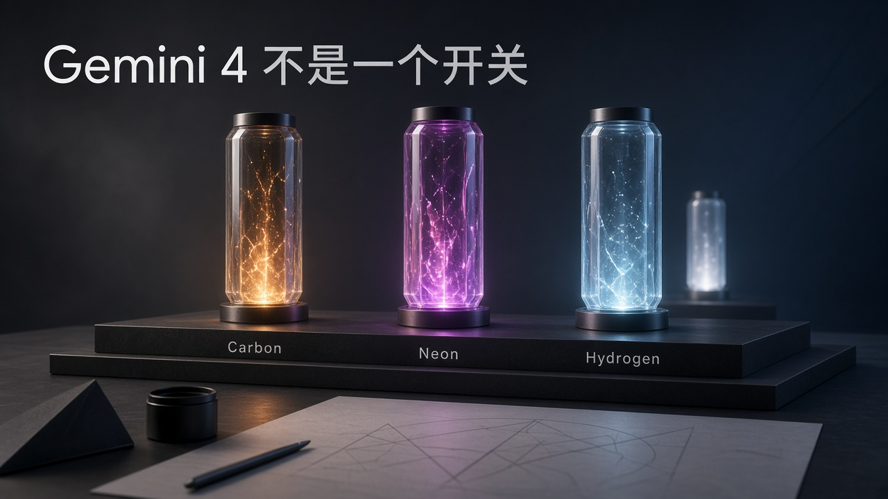
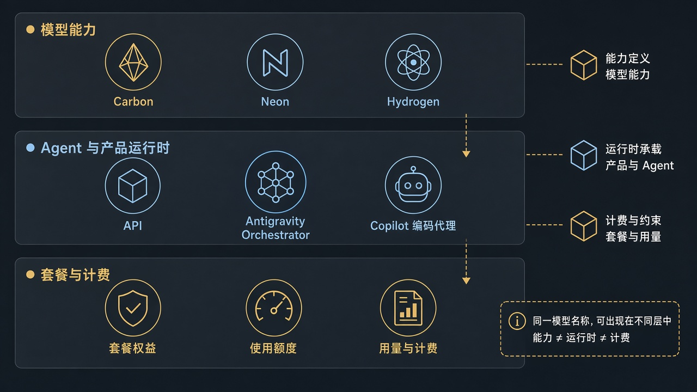
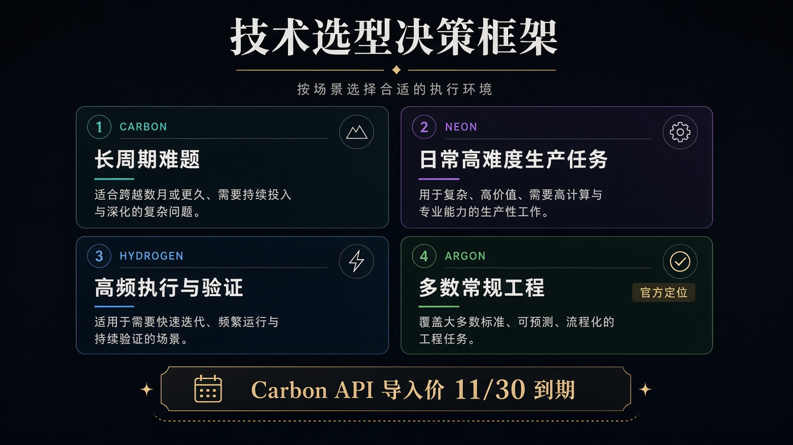

2026 年 11 月 10 日到 18 日，八天之内，Google 连续发布了 **Gemini 4 Carbon**、**Gemini 4 Hydrogen**、**Gemini 4 Neon**，并陆续进入 GitHub Copilot 与 Google Antigravity。团队容易把「Gemini 4」当成一个开关，问「我们要不要上 Gemini 4」。**这是错误的决策单元。**

真正要问的是：Carbon、Neon、Hydrogen、Argon 各自用在哪类任务上、跑在哪个运行时里、落在哪个套餐档、按什么价格计费，以及 **11 月 30 日导入价结束后团队的容量规划是否还成立**。把这些混在一起，就是把模型能力、Agent 运行时、套餐权益、计费单价搅成一锅粥，最后上线发现「Copilot 还是不会干活」或者「这月账单怎么翻倍了」。

本文依据截至 **2026-11-20** 的 Google 官方博客、GitHub Changelog 与 Gemini API / GitHub Copilot 定价页解读，**不是**本团队产线实测。我会在文末列出官方链接供核验。

*概念配图：把 Gemini 4 看成三根灯管代表的模型组合，而不是一个开关；后方更淡的是家族中的 Argon。*

<!--more-->

## 先分清三层：模型能力、Agent 运行时、套餐与计费不能混为一谈

技术负责人选型时最常见的错误，是把**模型能力**、**Agent / 产品运行时**、**套餐权益与计费**当成一回事。Gemini 4 这次发布让这个问题更明显：同一个模型名会出现在 Gemini API、Antigravity、GitHub Copilot、Gemini app 等不同运行时里，每个运行时有自己的 harness、编排策略、套餐边界和计费规则。

*分层示意：选型时把模型能力、Agent/产品运行时、套餐与计费分成三层看，同一名称可以同时出现在不同层。*

### 第一层：模型能力（官方定位，不是我们的实测结论）

从官方博客的定位看（[Carbon 博客](https://blog.google/innovation-and-ai/models-and-research/gemini-models/gemini-4-carbon-now-available/)、[Hydrogen 博客](https://blog.google/innovation-and-ai/models-and-research/gemini-models/introducing-gemini-4-hydrogen/)、[Neon 博客](https://blog.google/innovation-and-ai/models-and-research/gemini-models/introducing-gemini-4-neon/)）：

- **Carbon** 是「our strongest model」，强调网络安全能力与长周期（long-horizon）agentic workflows；在复杂多步编码/调试、开放式科研上冲击智力上限；相对 Argon「using more tokens than Argon to explore thoroughly, reason deeply, and run extended verification loops」。
- **Argon** 仍是「the ideal choice for the majority of software engineering and knowledge work」——这句话出现在 Carbon 博客里，意味着官方并不建议把所有工作都切到 Carbon。
- **Neon** 在 Carbon 的最难长周期项目与 Hydrogen 的快速日常执行之间，承担「demanding daily workflows」的中间带；官方称端到端完成速度快、少做未请求的改动、降低无根据陈述。默认 high thinking level 下，每任务成本比 Carbon 低 32%（官方公布，未经本团队复测）。
- **Hydrogen** 面向 everyday coding and agentic workflows 的速度与效率；可独立作为日常模型，也可在多模型工作流里给 Carbon/Argon 当 execution engine。官方称 high 默认设置下完成任务快 2.5 倍，Terminal-Bench 4.1 从 18.2% 到 57%（官方公布，未经本团队复测）。

**Thinking levels**：Carbon / Argon 支持 **low、medium（默认）、high** 三档；Neon / Hydrogen 支持 **low、medium、high（默认）、xhigh** 四档（官方定价与文档页）。上下文窗口都达到 1 million tokens（官方博客）。**重点在于**：Carbon 不是「Argon 的升级替代品」，Argon 还是多数工程该用的选择；Carbon 是在需要深度推理与长周期验证时才动用的最强火力。

### 第二层：Agent 运行时 ≠ 模型能力

同一个模型会出现在不同运行时：Gemini API / AI Studio、Google Antigravity（桌面、CLI、IDE 扩展）、Gemini app、GitHub Copilot 等。**运行时的 harness、编排策略、工具调用能力都会显著影响实际表现**，不能拿「模型能力」的榜单分数直接对比。

Neon 官方博客给了一个极好的例子（[Neon 博客](https://blog.google/innovation-and-ai/models-and-research/gemini-models/introducing-gemini-4-neon/)）：Neon 在 **mini-SWE harness** 上是 **12.8%**，在 **Google Antigravity** 中达到 **39.0%**，官方原话是「showing what the Antigravity harness unlocks」（官方公布，未经本团队复测）。这是 **3 倍差距**，而且是同一个模型。

这意味着：你不能把「Neon 在某个 harness 上是 12.8%」拿来跟「另一个模型在另一个 harness 上是 25%」直接比高低，说后者更强。模型能力是一回事，运行时 harness 是另一回事。

#### Antigravity Orchestrator：动态切换与 Neon + Hydrogen 编排

Antigravity 还引入了 **Orchestrator** 机制（[Hydrogen 博客](https://blog.google/innovation-and-ai/models-and-research/gemini-models/introducing-gemini-4-hydrogen/)、[Antigravity 博客](https://antigravity.google/blog/gemini-4-neon-in-google-antigravity/)）：可以在同一 session 里动态切换模型，例如 Carbon 与 Hydrogen。官方称在 Terminal-Bench 4.0 上接近 Carbon 的任务成功率，同时平均少消耗 24% quota、快 19%（官方公布，未经本团队复测）。

2026 年 11 月 18 日 Neon 发布时，Antigravity 博客进一步写明：**现已支持 Neon 作为 planner、Hydrogen 作为 executor**；Hydrogen 遇阻再交回 Neon 修计划。这是运行时层面的编排，不是模型本身的能力。

还有 **`/swarm`**：Carbon 博客写的是在 Antigravity **preview**，把一个 prompt 变成可追踪的协调 agent 团队。写「预览」不要升级成「已是默认生产编排」。

#### GitHub Copilot：模型选择器 ≠ 模型就是 coding agent

三篇 GitHub Changelog（[Carbon](https://github.blog/changelog/2026-11-10-gemini-4-carbon-in-github-copilot/)、[Hydrogen](https://github.blog/changelog/2026-11-13-gemini-4-hydrogen-in-github-copilot/)、[Neon](https://github.blog/changelog/2026-11-18-gemini-4-neon-in-github-copilot/)）写这些模型可在 model picker 中选择，并列出 VS Code、Visual Studio、Copilot CLI、GitHub Copilot coding agent、Copilot app、github.com、GitHub Mobile、JetBrains、Xcode、Eclipse；Hydrogen 还多写了 Copilot SDK。**Rollout will be gradual**——模型选择器里暂时看不到不代表官方未发布。

**不要把「出现在 Copilot 的模型选择器里」写成「该模型自己就是 Copilot coding agent」**，也不要比较「Copilot 不能自主执行」。这是两回事：模型是推理引擎，coding agent 是产品形态，两者之间还有工具调用、任务规划、文件操作等运行时层。

### 第三层：套餐、策略与计费（必须用官方最新页，不要混用过时口径）

#### Gemini API 定价（截至 2026-11-20，[定价页](https://aistudio.google.com/docs/pricing)）

单位均为每 100 万 tokens、美元。Output 含 thinking tokens。Carbon / Argon / Neon **不提供 Free tier**。Hydrogen 的 Free tier 为 Free of charge（付费档如下）。

- **Carbon**（`gemini-4-carbon`）：Input $2.00 **through November 30, 2026**；**$4.00 starting December 1, 2026**。Output（含 thinking）$10.00 through November 30, 2026；**$20.00 starting December 1, 2026**。Context caching $0.10 → $0.20（同日切换）。
- **Argon**（`gemini-4-argon`）：导入价与 Carbon 相同（官方定价页写明同样的 11/30 与 12/1 切换）。
- **Neon**（`gemini-4-neon`）：Input $3.00，Output $15.00，Context caching $0.15。无导入价截止日期。
- **Hydrogen**（`gemini-4-hydrogen`）：Paid Input $1.50，Output $7.50，Context caching $0.075；免费档 input/output/caching 为 Free of charge。

**重点**：在 2026-12-01 前，用导入价做容量规划的团队必须按 12/1 后的 Carbon（以及 API 上的 Argon）价格重算——Carbon 的 input 翻倍（$2 → $4），output 也翻倍（$10 → $20）。不能把导入价当成稳态成本。

#### GitHub Copilot 套餐与计费（[Models and pricing](https://docs.github.com/en/copilot/reference/copilot-billing/models-and-pricing)）

- **Carbon**（2026-11-10）：Copilot **Pro+、Max、Business、Enterprise**。未包含 Pro / Free。
- **Hydrogen**（2026-11-13）：Copilot **Pro、Pro+、Max、Business、Enterprise**。
- **Neon**（2026-11-18）：Copilot **Pro+、Max、Business、Enterprise**。未包含 Pro / Free。

计费机制：交互消耗 input / output / cached tokens，再换成 **GitHub AI Credits**，**1 AI credit = $0.01 USD**。各计划含额度，超出后按表计价。不要再用过时的 Cursor fast/slow requests 或把 Copilot 说成「按请求次」一刀切。

GitHub Copilot 模型单价（官方定价页表格，每 100 万 tokens）：

- **Gemini 4 Carbon**（带促销脚注）：表内 Input $2.00，Cached input $0.10，Output $10.00。脚注原文：promotional pricing ... **until December 1, 2026**。**Starting December 1, 2026**，pricing is $4.00 / $0.20 / $20.00。
- **Gemini 4 Argon**（带促销脚注）：表内同样 $2.00 / $0.10 / $10.00；脚注写 promotional pricing until December 1, 2026。**该脚注未写 12/1 之后的 Copilot 价格**——不要用 Google API 的 $4/$20 去冒充 Copilot 的 Argon 后续价。
- **Gemini 4 Hydrogen**：$1.50 / $0.075 / $7.50。
- **Gemini 4 Neon**：$3.00 / $0.15 / $15.00。

**重点**：引用日期时要并列两处官方措辞：Google API 是 through November 30, 2026 / starting December 1, 2026；Copilot 脚注是 until December 1, 2026 / starting December 1, 2026。两者都指向 12/1 起新价，但不要把两句话合并成一句不存在的原文。

#### Business / Enterprise 的 model policy：默认启用 ≠ 不能自主执行

官方文档写明：**Under default model enablement, new models are automatically enabled unless an administrator has turned off the global default or explicitly disables this model.**

这是**默认启用策略**，禁止改写成「企业版不能自主执行」或「必须每次人工审批才能跑模型」。管理员可以通过 Copilot settings 的 model policy 管理，但默认是自动启用的。

## 同期对照：OpenAI 也在发模型家族，而不是一个旗舰开关

2026 年 11 月 17 日，OpenAI 发布了 **GPT-6.2 Astra** 与 **GPT-6.2 Sol**（[OpenAI 博客](https://openai.com/index/introducing-gpt-6-2-astra-sol)）。官方：Astra 面向 hardest projects，API 输入/输出价较 GPT-6 Astra 低 20%，并给出 $8 input / $0.40 cached input / $40 output（每 100 万 tokens）；Sol 保持 GPT-6.1 Sol 的 API token 价格。

GitHub Copilot 定价表（同日核对）中：**GPT-6.2 Astra Default（≤ 272K）$8.00 / $0.40 cached / $10.00 cache write / $40.00 output**；Long context（> 272K）更高。**GPT-6.2 Sol Default（≤ 272K）$2.00 / $0.10 / $2.50 cache write / $10.00 output**。

这说明：**同一周行业在发模型家族，而不是一个旗舰开关**。OpenAI 也不是「只有 GPT-6.2 一个模型」，而是 Astra + Sol 分别对标不同任务强度。技术负责人在做 2026 年 Q4 与 2027 年 Q1 的模型策略时，不要把「上 Gemini 4」或「上 GPT-6.2」当成决策单元，而要把每个家族拆成任务强度 × 套餐 × 价格的组合。

## 技术负责人该怎么排组合

*决策框架：按任务类型排组合；Carbon 的 API 导入价将在 11 月 30 日结束后切换，12 月 1 日起执行新价，须以官方定价页为准。*

基于官方定位与计费规则，我给出以下可执行建议：

### 1. 采购/默认模型不要写「上 Gemini 4」，要写清 Carbon / Neon / Hydrogen / Argon 分别用于哪类任务、跑在哪个运行时、落在哪个套餐

错误决策：「团队从下周开始用 Gemini 4。」

正确决策：
- **日常 PR review、单元测试生成、文档补全**：优先考虑 **Argon**（官方定位是多数工程的理想选择）或 **Hydrogen**（速度与效率）。
- **复杂重构、跨模块调试、安全审计**：**Neon**（demanding daily workflows，成本比 Carbon 低 32%）。
- **最长周期、最重推理或开放式科研**：**Carbon**（strongest model，长周期 agentic workflows）。
- **高频修改、跑测试、执行层**：**Hydrogen**（execution engine）。

在 Antigravity 里，用 **Orchestrator**（Neon 做规划，Hydrogen 做执行）就不要把全流程长时间钉在 Carbon 上。在 GitHub Copilot 里，检查团队订阅的套餐（Pro / Pro+ / Max / Business / Enterprise），确认哪些模型在该档可用。

### 2. 在 2026-12-01 前，用导入价做容量规划的团队必须按 12/1 后的 Carbon（以及 API 上的 Argon）价格重算

如果团队在 11 月用 Carbon 的 $2 / $10（API）或 $2.00 / $10.00（Copilot）做过测算，12 月 1 日起这个价格会变成 **$4 / $20（API）和 $4.00 / $20.00（Copilot）**。input 翻倍，output 翻倍。

**不能把导入价当成稳态成本。** 如果团队的月度 token 消耗预估是基于导入价算的，现在就要重算。

### 3. 若团队停在 Copilot Pro（不是 Pro+），官方 changelog 显示可用 Hydrogen，但 Carbon / Neon 不在该档

这是**套餐权益问题**，不是「Copilot 不会干活」。要么升级到 Pro+ / Max / Business / Enterprise，要么把重任务放到 API / Antigravity 等已开通的表面。

### 4. 企业管理员应主动检查 model policy 的默认启用，而不是上线后才发现新模型已经对全员开放用量

Business / Enterprise 管理员可以通过 Copilot settings 的 model policy 管理模型启用。默认是自动启用，除非管理员关闭全局默认或显式禁用该模型。

**建议**：在 Gemini 4 Carbon / Neon 进入 Copilot 后，企业管理员先检查 model policy，确认哪些模型对哪些团队开放，避免上线后才发现「这月 AI Credits 超了」。

### 5. 内部选型以自己的仓库 + 既定运行时 + 既定策略做对照实验；不要把不同 harness 的榜单分数直接当模型高下

Neon 在 mini-SWE harness 上是 12.8%，在 Antigravity 中是 39.0%——**3 倍差距，同一个模型**。这说明 harness 与运行时的影响可能比模型本身更大。

**建议**：选几个团队真实的 PR 或 issue，在 Antigravity、GitHub Copilot、Gemini API 上各跑一遍 Carbon / Neon / Hydrogen / Argon，记录完成质量、耗时、token 消耗、成本。不要只看榜单，要看在自己的代码库里哪个组合最合适。

### 6. 能用 Orchestrator（Neon 或 Carbon 做规划，Hydrogen 做执行）就不要把全流程长时间钉在 Carbon 上

官方数据（未经本团队复测）：Orchestrator 在 Terminal-Bench 4.0 上接近 Carbon 的任务成功率，同时平均少消耗 24% quota、快 19%。如果团队用 Antigravity，先试试 Neon + Hydrogen 的编排，再判断是否需要全程 Carbon。

## 核验链接（发布前请再次确认）

1. [Gemini 4 Carbon 现已推出（2026-11-10）](https://blog.google/innovation-and-ai/models-and-research/gemini-models/gemini-4-carbon-now-available/)
2. [Gemini 4 Carbon 面向开发者（2026-11-10）](https://blog.google/innovation-and-ai/technology/developers-tools/gemini-4-carbon-developers/)
3. [Introducing Gemini 4 Hydrogen（2026-11-12，Last updated November 16, 2026）](https://blog.google/innovation-and-ai/models-and-research/gemini-models/introducing-gemini-4-hydrogen/)
4. [Introducing Gemini 4 Neon（2026-11-18）](https://blog.google/innovation-and-ai/models-and-research/gemini-models/introducing-gemini-4-neon/)
5. [Gemini 4 Neon in Google Antigravity（2026-11-18）](https://antigravity.google/blog/gemini-4-neon-in-google-antigravity/)
6. [Gemini Developer API pricing](https://aistudio.google.com/docs/pricing)
7. [GitHub Changelog：Gemini 4 Carbon in GitHub Copilot（2026-11-10）](https://github.blog/changelog/2026-11-10-gemini-4-carbon-in-github-copilot/)
8. [GitHub Changelog：Gemini 4 Hydrogen in GitHub Copilot（2026-11-13）](https://github.blog/changelog/2026-11-13-gemini-4-hydrogen-in-github-copilot/)
9. [GitHub Changelog：Gemini 4 Neon in GitHub Copilot（2026-11-18）](https://github.blog/changelog/2026-11-18-gemini-4-neon-in-github-copilot/)
10. [Models and pricing for GitHub Copilot](https://docs.github.com/en/copilot/reference/copilot-billing/models-and-pricing)
11. [Introducing GPT-6.2 Astra and Sol（2026-11-17）](https://openai.com/index/introducing-gpt-6-2-astra-sol)

---

**孙升隆（SSLoong）**，devloong.com，技术负责人。本文依据截至 2026-11-20 的官方公告与定价页解读，不是本团队产线实测。如官方页与本文有出入，以官方最新页为准。
