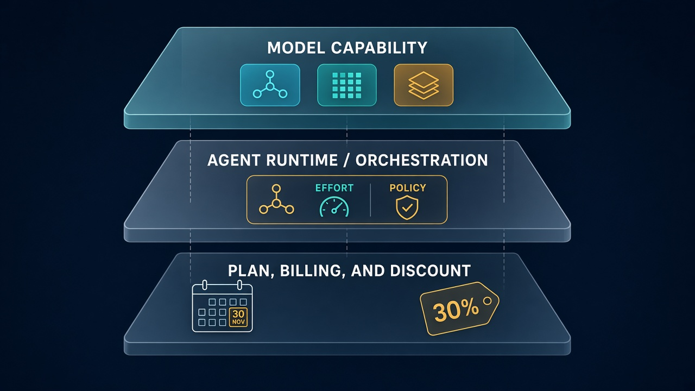
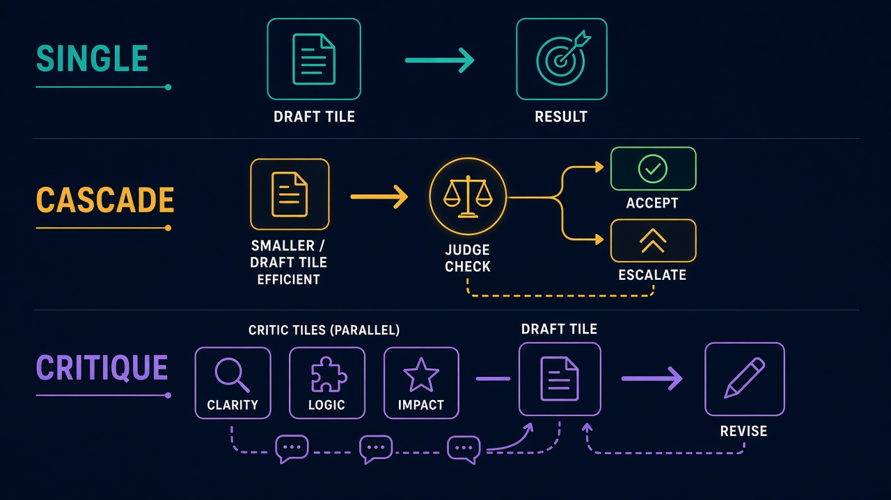

2026 年 10 月 28 日，GitHub Copilot Fusion **正式 GA**。团队容易把 model picker 里的 Fusion 当成又一个模型，问「我们要不要换到 Fusion」。**这是错误的决策单元。**

真正要问的是：Fusion Standard / High / Max 分别用在哪类任务上、管理员模型策略如何配置、Single / Cascade / Critique 三种编排模式会怎样影响延迟与成本、**11 月 30 日 30% 折扣结束后的账单规划是否还成立**，以及 Terminal-Bench 4.1 的 71.2% 在自己的任务中能不能复现。把这些混在一起，就是把模型能力、Agent 运行时、套餐权益、计费单价搅成一锅粥，最后上线发现「切了 Fusion 账单翻倍了」或者「模型池变了导致质量下滑」。

本文依据截至 **2026-11-23** 的 GitHub Changelog（2026-10-28 与 2026-11-17）、GitHub Docs 概念页、个人计费页与 Terminal-Bench 4.1 公开榜解读，**不是**本团队产线实测。我会在文末列出官方链接供核验。

*概念配图：Fusion 不是 model picker 里的又一个模型，而是智能路由与编排层，下方分出 Standard、High、Max 三档 effort level。*

<!--more-->

## 先分清三层：模型能力、Agent 运行时、套餐与计费不能混为一谈

技术负责人选型时最常见的错误，是把**模型能力**、**Agent / 产品运行时**、**套餐权益与计费**当成一回事。Fusion 让这个问题更明显：同一个「Fusion」名称同时出现在 effort level 选择器、编排模式、管理员策略、计费折扣四个层面，每个层面有自己的决策边界。

*决策分层示意：模型能力由 Fusion 动态选择，运行时负责编排（Single / Cascade / Critique），最上层是计划、折扣与管理员策略。图中日历标注 30 NOV、价签 30%，提示 2026 年 11 月 30 日折扣截止。*

### 第一层：Fusion 是运行时路由与编排器，不是模型本身

官方概念文档写得很清楚（[About GitHub Copilot Fusion](https://docs.github.com/en/copilot/concepts/models/copilot-fusion)）：**Copilot Fusion is an intelligent runtime model router and orchestrator**。它为任务选择模型与 execution pattern，然后返回**一个** response。

**你在 model picker 里选择 Fusion，选的不是某个具体模型。** 你选择的是一个系统，它会在运行时为每个任务路由、编排模型。你不需要在任务过程中手动切换模型，也不需要判断哪个模型适合哪一步。对于每个 prompt，Fusion 决定使用哪些模型以及它们如何协作，而你只需要选择正确的 effort level。

Fusion 会考虑**实时系统健康与可用性**。路由发生在自然缓存边界（natural cache boundaries），以及对话复杂度发生较大变化时，以避免没有质量提升的额外缓存成本。

它按任务评估，并使用 reasoning、code generation、debugging、tool use 等 capability signals，选择能满足当前 effort level 质量门槛的、尽量高效的 execution pattern。**推理力度与模型选择是 per step 的**。模型池会随新模型与 GitHub 评估而变化——不要把 11-17 新增的 Claude Sonnet 5.5 / GPT-6.1 Terra / MAI-Code-2 名单写成固定名单。

### 第二层：三种编排模式（Single / Cascade / Critique）决定延迟与成本

Fusion 会在每个 prompt 评估后，选择三种 execution pattern 之一：

*三种 execution pattern 示意：Single 一次完成，Cascade 由 judge 决定接受或升级，Critique 多模型并行审阅后由原模型修订。*

| Execution pattern | 描述（官方文档，2026-11-23 核对） |
| --- | --- |
| **Single** | 一个模型完成任务。行为类似一次单模型请求。 |
| **Cascade** | 高效模型起草，judge 检查草稿，决定接受或 escalate 到更强模型。 |
| **Critique** | 一个模型起草，**多个模型并行、独立** critique，反馈汇总后由**原模型**修订。 |

**每个 prompt 都可选择不同 pattern，同一 session 内后一个 prompt 可以和前一个不同。** 选择 pattern 是轻量步骤，增加的延迟很小。

**只在任务需要时才增加额外模型调用；简单任务不会为了不需要的 review 等待或消耗 AI credits。** Single 行为类似一次单模型请求。Cascade 和 Critique 会更久，因为包含用于 review 的模型调用。

过程中可跟踪每一步及所用模型；中间草稿可能被修订或丢弃，**只向用户展示最终回复**。回复下方可 hover effort level 名称，查看用过的模型列表。

### 第三层：三档 effort level（Standard / High / Max）与 Fast

官方文档（2026-11-23 核对）对三档 effort level 的定义：

| Effort level | 优先级 | 典型使用场景 |
| --- | --- | --- |
| **Fusion Standard** | 平衡成本、质量与延迟。 | Everyday work。文档写它会为每个任务选择一个模型。 |
| **Fusion High** | 带 moderate token savings 的平衡编排。 | 适合范围清晰的较大改动，例如修复杂 bug 或跨多文件修改，且额外模型调用值得花费时间和 AI credits。 |
| **Fusion Max** | 在仍考虑 token efficiency 的前提下追求 frontier capability。 | 需要最深推理与最彻底分析的任务。 |
| **Fusion Fast** | **用户不可选**。只在 Visual Studio Code inline chat 中、需要 fast models 的场景使用。 | 不要写成用户可以切换到 Fast。 |

**若 picker 里没有 Fusion Max，可能是 Fusion Max 所需的一个或多个模型被禁用。** 检查管理员模型策略（后文详述）。

**Fusion 没有自己的 context window**；界面上显示的是按所用模型中较小限制得出的保守值。

### 第四层：套餐、策略与计费（必须用官方最新页，不要混用过时口径）

#### 计费规则（官方文档，2026-11-23 核对）

[个人计费文档](https://docs.github.com/en/copilot/concepts/billing-and-usage/individuals/billing) 与 [Fusion 概念文档](https://docs.github.com/en/copilot/concepts/models/copilot-fusion) 明确写明：

> **通过 2026 年 11 月 30 日**，付费 Copilot 计划用户使用 Copilot Fusion 可获模型费用 **30%** 折扣。

- 按实际用到的每个模型的标准费率计费，**没有单独的 Fusion 收费**。
- Fusion High 和 Fusion Max 可以在一个任务中使用多个模型，因此可能比 Fusion Standard 消耗更多 AI credits。
- 会尽量把主对话保持在同一模型上，以便继续享受 cached tokens；协助模型（如 reviewer）只获得所需上下文。

**重点**：在 2026-12-01 后，30% 折扣结束。用导入价做容量规划的团队必须按 12/1 后的标准费率重算——不能把折扣期当成稳态成本。

**用量以 GitHub AI Credits 计；1 AI credit = $0.01 USD**。付费个人档位价格（仅在确有必要时点到，不要做成报价单）：Pro $10 / 1,500 credits；Pro+ $39 / 7,000；Max $100 / 20,000。包含额度按自然月 UTC 重置，不结转。

**另有一条（不要和 Fusion 的 30% 搞混）**：付费计划在 Copilot Chat 使用 auto model selection，或使用 Copilot cloud agent 时，模型费用有 10% 折扣。这是另一个折扣项。

#### 客户端范围（需要分述 Changelog 与 Docs 两个来源）

2026-10-28 Changelog GA 时写：**所有 Copilot plans，在 Visual Studio Code、GitHub Copilot app、GitHub Copilot CLI、JetBrains IDEs**。Support for additional clients is coming soon。

2026-11-17 Changelog 更新：**新增 github.com、Visual Studio、GitHub Mobile beta（iOS 和 Android）**。**生产版 GitHub Mobile 仍是 coming shortly**，不要写成已经全量上线。

概念文档的 GA 列表（可能滞后于 11-17 Changelog）：Visual Studio Code、Copilot CLI、GitHub Copilot app、JetBrains IDEs、Copilot in the cloud on GitHub.com。

**正文写客户端范围时：11-17 Changelog 已增加 github.com、Visual Studio、GitHub Mobile beta；生产版 Mobile 尚未宣布 GA。以 Changelog + 当前客户端版本为准，并注明概念文档列表可能滞后。**

#### 管理员策略：默认启用 ≠ 不能自主执行

官方 10-28 Changelog 明确写：

- Fusion **只使用**企业/组织模型策略中已启用的模型。
- 企业管理员可以查看 Fusion 的候选模型，**独立设置**每个模型对 Fusion 的有效策略状态，并且可以**只对 Fusion 禁用某模型、同时不对该模型的所有人禁用**。
- 管理员可以把任意 effort level 的 Copilot Fusion 设为使用 Enterprise managed settings 的用户的默认模型。

**这是策略与权限配置，禁止写成「Fusion 不能自主执行」或「某一方不能干活」。** 管理员可以限制 Fusion 可用的模型，也可以把 Fusion 设为默认；这不等于能力缺陷。

若 Fusion 要用的模型对你一个都不可用，Fusion 不会出现在 model picker 中。这也不是「Fusion 不能自主执行」，而是策略限制。

## 怎么读 Terminal-Bench 4.1 的 71.2%：Agent + 模型组合，不是模型单独打分

2026-11-17 Changelog 公布：Copilot Fusion Max 在 **Terminal-Bench 4.1** 上达到 **71.2%** resolution rate，领先 Opus 5.5 与 Fable 5.2 **5.4 个百分点**；成本比 Fable 5.2 低 **88%**、比 Opus 5.5 低 **57%**。独立榜单由 Stanford、Harbor 与 Laude Institute 托管。

我在 2026-11-23 打开 [Terminal-Bench 4.1 公开榜](https://www.tbench.ai/)，核对数字（须带误差区间，并写明是榜单公布、非本团队实测；成本是该榜跑批总成本，不是 Copilot 对终端用户的标价）：

1. **Copilot Fusion(max) / GitHub Copilot**：71.2% ± 2.9%，Nov 17, 2026，3.3B tokens，$2.0k
2. **Opus 5.5(max) / Claude Code**：65.8% ± 3.1%，Sep 22, 2026，8.0B，$4.7k
2. **Fable 5.2(max) / Claude Code**：65.8% ± 2.8%，Nov 9, 2026，15.7B，$16.5k

GitHub 所说「领先 5.4 个百分点」「比 Fable 5.2 便宜 88%、比 Opus 5.5 便宜 57%」与上述总成本（2.0 / 16.5 ≈ 12% 即约低 88%；2.0 / 4.7 ≈ 43% 即约低 57%）相符。

**关键点：榜单对比的是「模型 + Agent」组合，不是模型单独打分。** Copilot Fusion Max 是 **Fusion Max 跑在 GitHub Copilot 上**，对阵 **Opus 5.5 (max) 跑在 Claude Code 上**。不能写成「Fusion 比 Opus 更强」，因为 Fusion 是编排器，不是模型。

**这个数字是 Agent + 模型** 组合在 Terminal-Bench 4.1 任务上的表现，且是基准跑批成本，不是 Copilot 对终端用户的标价。禁止换算成「团队每任务多少钱」，因为团队用量、模型选择、折扣都会不同。

另外，10-28 Changelog 还公布了 **Artificial Analysis Coding Agent Index**：Copilot Fusion Max scored 60, within two points of Claude Code with Opus 5.5 Max；约一半的 average API cost per task，约一半 tokens，每任务约少 40% 时间。**这是 GitHub 在 10-28 Changelog 中的表述，不是我们复核过的第三方页面数字**。若引用，必须写明「GitHub 官方 Changelog 公布，未经本团队复测」，且不要和 Terminal-Bench 4.1 数字混在同一个比较里，因为两者是不同的榜单、不同的评测规则。

同榜还有其他条目（例如 Gemini 4 Carbon (high) / Antigravity CLI 64.5% ± 3.2%）。**不要展开打模型家族战**，以免与上周五文章《Gemini 4 不是一个模型：Carbon、Neon、Hydrogen 一周内到齐，技术负责人该怎么排组合》重复；如需一句带过，只为说明「同一榜上比的是不同运行时」。

## 技术负责人该落地的策略：编排、模型策略、账单与边界

基于官方文档与榜单数字，我给出以下可执行建议：

### 1. 默认 effort level 不要写「上 Fusion」，要写清 Standard / High / Max 分别用于哪类任务

错误决策：「团队从下周开始用 Fusion。」

正确决策：
- **日常 PR review、单元测试生成、文档补全、快速修改**：**Fusion Standard**（平衡成本、质量与延迟，everyday work）。
- **复杂重构、跨模块调试、范围清晰的较大改动**：**Fusion High**（平衡编排，带 moderate token savings，适合修复杂 bug 或跨多文件修改）。
- **最长周期、最重推理、开放式科研、安全审计**：**Fusion Max**（frontier capability，需要最深推理与最彻底分析）。

**不要把全流程长时间钉在 Fusion Max 上**。Fusion High 和 Max 会在需要时调用多个模型，消耗更多 AI credits。如果任务不需要那么深的推理，用 Standard 就够了。

### 2. 管理员应主动配置 Fusion 可用模型，并决定是否设为默认

企业管理员可以通过 Copilot settings 的 model policy：

- 查看 Fusion 的候选模型。
- **独立设置**每个模型对 Fusion 的有效策略状态。
- **只对 Fusion 禁用某模型、同时不对该模型的所有人禁用**（这样用户还能手动选该模型，但 Fusion 编排时不会用到它）。
- 把任意 effort level 的 Copilot Fusion 设为使用 Enterprise managed settings 的用户的默认模型。

**若团队需要严格控制成本或模型选择，应在 Fusion 上线前配置好策略**，而不是上线后才发现「这月 AI Credits 超了」或「Fusion Max 在 picker 里消失了」。

若 Fusion 要用的模型对你一个都不可用，Fusion 不会出现在 model picker 中。这不是「Fusion 不能自主执行」，而是策略限制——检查管理员模型策略，确认至少有一个 Fusion 需要的模型被启用。

### 3. 在 2026-12-01 前，用 30% 折扣做容量规划的团队必须按 12/1 后的标准费率重算

如果团队在 11 月用 Fusion 的 30% 折扣做过测算，12 月 1 日起这个折扣会结束。按实际用到的每个模型的标准费率计费，没有单独的 Fusion 收费，但 High/Max 可能因多模型调用消耗更多 AI credits。

**不能把折扣期当成稳态成本。** 如果团队的月度 AI Credits 消耗预估是基于折扣算的，现在就要重算。

### 4. 仍应在合规或必须钉死模型时手动选模型，不要指望 Fusion 去满足所有策略约束

Fusion 从受支持模型的定义列表中选择；可用模型取决于策略与订阅类型，并可能随时间变化。不会使用：

- 计划中不可用的模型。
- 管理员策略排除的模型。
- 把 Copilot 限制为 data-resident 或 FedRAMP-compliant 模型的策略所排除的模型。
- 限制 Evaluation models 的策略所排除的模型。

**如果团队有数据驻留、合规、或必须钉死特定模型的需求，应该手动选模型，而不是用 Fusion**。Fusion 的模型池会随时间变化，你无法保证它一直用某个特定模型。

### 5. 提交前检查被丢弃草稿留下的工作区改动；不要指望 Fusion 去拉起 subagents

官方文档的限制（2026-11-23 核对）：

- **Fusion 与 subagents 分开工作，不会启动 subagents**。
- **若 Fusion 丢弃一份草稿，该草稿已在工作区做的修改（例如文件编辑）不会自动撤销**。提交前要人工检查。
- execution patterns 与模型池可能随时间变化。

**不要把 Fusion 当成万能层**。它是编排器，不是 subagents 启动器。如果任务需要 subagents（例如 Copilot cloud agent），应该手动启动，而不是期待 Fusion 去做。

如果 Fusion 在 Cascade 或 Critique 过程中丢弃了一个草稿，那个草稿可能已经改了文件、跑了命令。**这些改动不会自动撤销**。提交前要检查 diff，确认没有不想要的改动。

### 6. 内部选型以自己的仓库 + 既定运行时 + 既定策略做对照实验；不要把不同 Agent 的榜单分数直接当模型高下

Terminal-Bench 4.1 的 71.2% 有决策参考价值，但不能写成「换 Fusion 就比 Opus 强」，因为：

- 榜单对比的是 **Fusion Max 跑在 GitHub Copilot 上** vs **Opus 5.5 (max) 跑在 Claude Code 上**。
- 不同 Agent 的 harness、工具调用、环境配置都会影响结果。
- 榜单数字是在 Terminal-Bench 4.1 任务上的表现，不一定能直接复现到你的任务中。

**建议**：选几个团队真实的 PR 或 issue，在 GitHub Copilot 里分别用 Fusion Standard / High / Max、以及手动选择的具体模型（例如 Claude Sonnet 5.5、GPT-6.1 Terra）各跑一遍，记录完成质量、耗时、token 消耗、成本。不要只看榜单，要看在自己的代码库里哪个组合最合适。

### 7. 本地模型（public preview）一小节即可，不要写成团队默认方案

官方文档写：Windows 且机器满足规格时，可在 Copilot CLI / Copilot app / VS Code 内安装 **MAI Code 1.1 Flash**；仅 Fusion Standard 可能选用。Copilot CLI 中若本地安装 **Qwen3.8 Flash Next**（例如经 Ollama），且被识别为 `qwen3.8-flash-next-local`，Fusion Standard 也可能使用；支持 Windows、macOS、Linux。

**预览期需打开实验功能**：Copilot app 中打开 Local model auto routing；CLI 用 `--experimental` 或 `/experimental on`。

也可不用 Fusion，而是给 custom agent 指定本地模型。

**这一段宜短，标成预览，避免写成团队默认方案**。本地模型是 public preview，可能变更，且需要实验功能开关。不要把它当成生产方案推荐，除非团队明确要用本地模型。

## 和上周五 Gemini 4 文章怎么错开看

上周五（2026-11-20）已发布《Gemini 4 不是一个模型：Carbon、Neon、Hydrogen 一周内到齐，技术负责人该怎么排组合》。那篇讲「不要把 Gemini 4 当成一个开关」，本篇讲「不要把 Copilot Fusion 当成 model picker 里的又一个模型」。

两篇的共同点是：**行业在发模型家族与编排器，而不是一个旗舰开关**。技术负责人在做 2026 年 Q4 与 2027 年 Q1 的模型策略时，不要把「上 Gemini 4」或「上 Fusion」当成决策单元，而要把每个家族拆成任务强度 × 套餐 × 价格的组合，把每个编排器拆成 effort level × 模型策略 × 账单规划的组合。

**不要复述 Carbon / Neon / Hydrogen 的选型细节**，那是上周五文章的内容。本篇重点是 Fusion 的编排模式、策略配置、折扣截止与榜单解读。

**不要把同日（2026-11-17）另一则 Changelog「OpenAI's GPT-6.2 Astra and GPT-6.2 Sol now available」写成已经进入 Fusion 模型池**，官方 Fusion 更新没有点这两个名字。

## 核验链接（2026-11-23 核对）

1. [GitHub Changelog：Route and orchestrate models with GitHub Copilot Fusion（2026-10-28）](https://github.blog/changelog/2026-10-28-route-and-orchestrate-models-with-github-copilot-fusion/)
2. [GitHub Changelog：GitHub Copilot Fusion updates: more availability, benchmarks, and models（2026-11-17）](https://github.blog/changelog/2026-11-17-github-copilot-fusion-updates-more-availability-benchmarks-and-models/)
3. [About GitHub Copilot Fusion（官方概念文档）](https://docs.github.com/en/copilot/concepts/models/copilot-fusion)
4. [Usage-based billing for individuals（个人计费文档）](https://docs.github.com/en/copilot/concepts/billing-and-usage/individuals/billing)
5. [Terminal-Bench 4.1 公开榜](https://www.tbench.ai/)

---

**孙升隆（SSLoong）**，devloong.com，技术负责人。本文依据截至 2026-11-23 的官方 Changelog 与文档解读，不是本团队产线实测。如官方页与本文有出入，以官方最新页为准。
