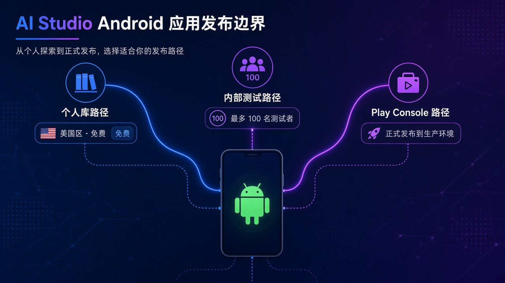
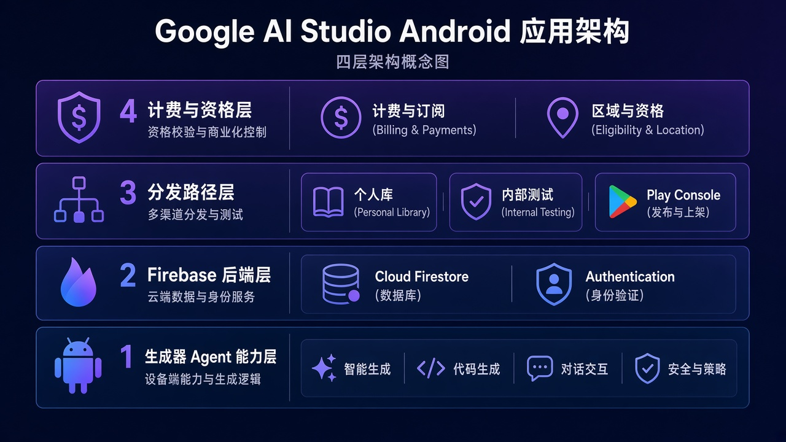
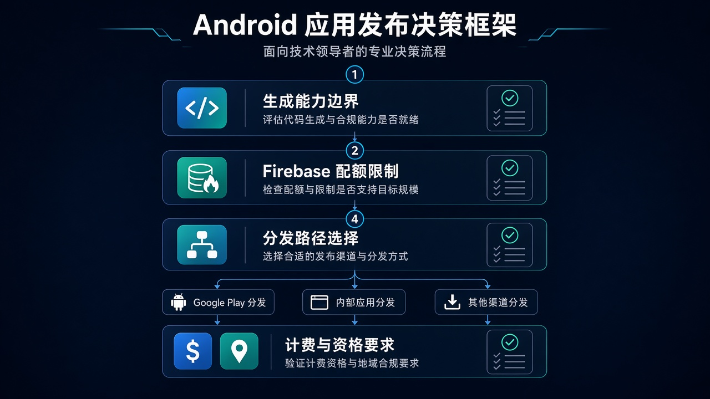

2026 年 11 月 17 日，Google Developers Blog 发文宣布，Google AI Studio 可在数分钟内从一句 prompt 构建 **production-ready** 的 Kotlin Android 应用，并 **publish to the Play Store in minutes**，全程 **at no cost**。([Build full-stack Android apps with Gemini in Google AI Studio](https://developers.googleblog.com/build-full-stack-android-apps-with-gemini-in-google-ai-studio/))

但对技术负责人来说，真正该停下来看的不是「我们要不要用 AI Studio 生成 Android 应用」，而是：**不要把博客营销语里的「上架 Play」当成生产发布开关。** 技术负责人要分开看四层：生成器 / Agent 能力边界、Firebase 后端开通与安全规则审查、三条完全不同的分发路径（个人资料库、内部测试、生产发布）、以及计费与地区/账号资格限制。这些边界不钉死，协议再稳也落不了生产。

本文依据截至 **2026-11-27** 的 Google 官方博客、AI Studio 产品文档、Firebase 文档与 Google Play 帮助中心解读，**不是**本团队产线实测。我会在文末列出官方链接供核验。

*概念配图：从 prompt 到 Play Store 不是一条直线，而是生成能力、Firebase 后端、分发路径、计费资格四层决策边界的组合。*

<!--more-->

## 先别把「博客营销语」和「产品文档能力边界」混在一起

Google Developers Blog 的营销语使用 **production-ready**、**publish to the Play Store in minutes**、**at no cost**。但产品文档 ([Google AI Studio - Build Android apps](https://aistudio.google.com/docs/aistudio-android)) 和 Google Play 帮助中心 ([Create & manage AI-generated personal apps on Google Play](https://support.google.com/googleplay/answer/18936837)) 写的是完全不同的三件事：

1. **个人资料库（personal library）**：私有、不在公开目录、不做面向公开商店的审核、免费、**仅限美国**、18+ 个人账号（不支持 Workspace 账号）。这是「给自己装到手机上」，不是生产发布。
2. **内部测试轨道（internal testing track）**：需 Google Play Developer 账号（官方写一次性 $25 注册费）、完备开发者资料；最多 100 名测试人员；AI Studio 用托管 keystore 签名。产品文档明确：**Publishing is limited to the internal testing track only. Production releases must be managed directly in the Google Play Console.**
3. **生产/公开分发**：必须在 Play Console 里走正式流程，不是 AI Studio 一键完成。

这三条路径的合规要求、审核流程、计费模型、可见性范围完全不同。技术负责人在读博客营销语时，必须拆清楚「publish to Play Store」指的是哪一条路径——对不在美国或使用 Workspace 账号的团队，连第一条个人资料库都不可用。

*分层示意：生成能力、Firebase 后端、分发路径、计费资格是四个独立决策层，不要混成一个「能不能用 AI Studio 上架生产」。*

## 第一层：生成器 / Agent 能力边界（官方定位，不是我们的实测结论）

产品文档写明：Android 应用在 AI Studio 里是 **client-side only**；需要 server-side runtime 的能力（secrets management、multiplayer、Google Workspace APIs）**仅适用于 web apps**。([aistudio.google.com/docs/aistudio-android](https://aistudio.google.com/docs/aistudio-android))

生成方在博客里称为 **Build agent**，在产品文档里称为 **Antigravity Agent**——两处名称都要按来源引用，不要混成一个官方专有名词而不加出处。

### 架构限制（官方文档，非本文实测）

- **单 Activity、单模块**：single-activity、single-module；不支持多模块架构。
- **仅 Kotlin + Jetpack Compose**：不支持 Java 或 XML layout。
- **无 NDK / C / C++**：不支持原生代码。
- **无 Wear OS / Android TV**：只支持手机和平板。
- **模拟器限制**：无相机/NFC/蓝牙，GPS 为模拟，Google Play 服务（含 Google Sign-In、Maps）在模拟器不可用、需真机。

这些限制意味着：你不能把需要多模块分层架构、或需要原生 C/C++ 加密库、或需要 Wear OS 表盘的项目交给 AI Studio 生成。技术负责人要做的第一个判断是：**列出你的 Android 项目依赖哪些能力，逐条核对是否在上述限制范围内。**

### 导出：官方来源冲突

这是官方文档内部冲突的一个例子：

- 产品文档 ([aistudio.google.com/docs/aistudio-android](https://aistudio.google.com/docs/aistudio-android)) 明确写：**ZIP download only. GitHub export is not yet available for Android projects.**
- 但 Learn 页 FAQ ([aistudio.google.com/learn/build-android-apps](https://aistudio.google.com/learn/build-android-apps)) 却写可以 **sync your app with GitHub**。

这是官方来源冲突。**正文必须点出冲突，建议读者以当前产品 UI 和产品文档页为准，不要自行裁定「其实已经支持」。** 如果团队的 CI/CD 流程强依赖 GitHub 集成，那么在官方解决这个文档冲突之前，要么接受 ZIP 导出手动推 GitHub，要么等官方明确支持。

## 第二层：Firebase 后端开通与安全规则审查

AI Studio 可以自动开通 Firebase 后端，但这不是自动保护——技术负责人要盯住三件事：**开通了什么、配额怎么算、规则谁负责审。**

### 开通什么（需用户确认，不是自动）

当你在 AI Studio 中描述需要数据持久化、用户登录或 AI 特性的应用时，Agent 会**主动检测**这些需求并弹出设置卡片。**只有用户在卡片上点击 Enable Firebase 才会开通**，不是自动开通。([Firebase docs - Add Firebase to your Google AI Studio app](https://firebase.google.com/docs/ai-assistance/ai-studio-integration))

可开通的服务包括：

- **Cloud Firestore**：NoSQL 云数据库，包含自动生成的 Security Rules (`firestore.rules`)。
- **Firebase Authentication**：Google Sign-In 流程。
- **Firebase AI Logic + App Check**：Android 上调用 Gemini 模型时，不用在 APK 里硬编码 Gemini API key。App Check 验证请求来自真实应用。

调试/模拟器/USB 安装用 AI Studio 托管的 **App Check debug token**；Play 发布包自动切到 **reCAPTCHA Enterprise**（官方也称 **Google Fraud Defense, formerly reCAPTCHA Enterprise**——按你复核到的现行名称写，并注明来源）。

### Firestore 共享配额：「AI shared quota」组（官方表，须按页面原文引用）

Firebase 文档明确写明：所有 AI Studio 生成的 Cloud Firestore 数据库被放在同一个 **「AI shared quota」组**，共享以下限额 ([Firebase docs](https://firebase.google.com/docs/ai-assistance/ai-studio-integration))：

| 指标 | 配额 |
| --- | --- |
| Stored data | 1 GiB total |
| Network egress | 10 GiB per month |
| Write units | 40,000 writes/day |
| Read units | 50,000 reads/day |
| Real-time update units | 50,000 updates/day |

**触达日限额后，整组暂停，约太平洋时间午夜恢复。** 文档还写明：**Starter Tier is not available for Android apps.**

如果团队要升到 Blaze 付费计划，官方流程是：

1. 在 AI Studio 或 Firebase 控制台添加 billing（开通计费在 AI Studio 里是 **Public Preview**）。
2. **重点**：加 billing 升到 Blaze **不会自动**取消共享配额，必须在 Firebase 控制台对库点 **Upgrade database**。在 AI Studio 里开通计费会把关联账单账户升级为付费账户，可能让同一账单下其他项目也开始按量计费——这是技术负责人必须盯的风险。

技术负责人要做的第二个判断是：**如果日活超过 50,000 reads/day 或 40,000 writes/day，就会触达限额，整组暂停。测算你的应用每日读写量，提前决定要不要升 Blaze，以及要不要把 AI Studio 项目接到隔离的 GCP 账单账户上。**

### Security Rules：官方要求人工审查

Firebase 文档明确写明 ([Firebase docs](https://firebase.google.com/docs/ai-assistance/ai-studio-integration))：

> **Generative AI can make mistakes. Always check its changes or output before deploying to production.**

> **Google and Firebase are not liable for any security vulnerabilities in AI-generated Security Rules. It's your responsibility to review and test the generated Security Rules before deploying them to production.**

另一个要注意的点：**若只在 Firebase 控制台改规则，随后 AI Studio 迭代可能覆盖。** 官方建议用 AI Studio Agent 调整 Security Rules，以确保改动与应用逻辑对齐。

技术负责人要做的第三个判断是：**上线前人工审查 Security Rules，明确谁负责审、审到什么粒度、以及在 Firebase 控制台手改规则后如何避免被 AI Studio 下次迭代覆盖。**

### 服务账号与权限

选用已有 GCP 项目时，AI Studio 会创建服务账号 `ais-sandbox@PROJECT_ID.iam.gserviceaccount.com`（请按官方文档确认准确邮箱格式），以允许 AI Studio 管理端访问。

**删除 AI Studio 应用不会自动删除 Firebase 项目或数据。** Agent 不能直接增删库里的数据，但会生成可执行这些操作的应用代码。

技术负责人要做的第四个判断是：**决定要不要让 AI Studio 创建新 Firebase 项目，还是接到现有项目上。如果接到现有项目，要核对服务账号权限范围，以及删除 AI Studio 应用后的清理流程。**

## 第三层：三条分发路径（不可混淆，各有资格限制）

这是技术负责人最容易踩坑的地方：博客说「publish to the Play Store」，但实际有三条完全不同的路径，各自的合规要求、审核流程、计费、可见性范围、地区与账号资格限制都不一样。

*决策框架：个人资料库、内部测试、生产发布是三条完全不同的路径，不要混成一条「上架」。*

### 路径一：个人资料库（Personal Library）

Google Play 帮助中心 ([Create & manage AI-generated personal apps on Google Play](https://support.google.com/googleplay/answer/18936837)) 明确写明：

**资格要求**：
- **位于美国**（Be located in the United States）。
- **18+ 已年龄验证的个人 Google 账号**（Have an 18+ age-verified personal Google Account）。
- **不支持 Workspace / 工作或学校账号、不支持 Family Link**（Work or school (Google Workspace) accounts and supervised accounts (Family Link) are not supported）。
- **Play Store app 53.5+**。

**特性**：
- **私有、不在公开目录**（Private to you / not available in Play's public store catalog）。
- **不做面向公开商店的审核**（Not reviewed by Play for the public Play Store catalog）。
- **免费**（no cost）。
- **不能含广告变现**（No Ads: AI-generated personal apps cannot include ad monetization or ad SDKs）。
- **禁止高风险权限**：无障碍/SMS/通话记录/安装包/通知监听等（Restricted Android permissions: AI-generated personal apps cannot request high-risk permissions, including Accessibility, SMS, Call Log, Install Packages, and Notification Listener）。
- **禁止金融/加密货币、真钱赌博、政府服务等类别**（Prohibited categories: Financial services or cryptocurrency apps, real-money gambling apps, and government services apps are not permitted）。

这是「给自己装到手机上」，不是生产发布。**对不在美国或使用 Workspace 账号的团队，不能把这条路径写成默认可用。**

### 路径二：内部测试轨道（Internal Testing Track）

产品文档 ([aistudio.google.com/docs/aistudio-android](https://aistudio.google.com/docs/aistudio-android)) 写明：

- **需 Google Play Developer 账号**（官方写一次性 $25 注册费）。
- **完备开发者资料**。
- **最多 100 名测试人员**。
- **AI Studio 用托管 keystore 签名**。
- **文档明确**：**Publishing is limited to the internal testing track only. Production releases must be managed directly in the Google Play Console.**

这是用于团队内部测试或小范围 alpha 测试，不是公开发布。测试人员可以通过链接加入，但应用仍不在公开目录里。

### 路径三：生产/公开分发

产品文档已经明确写：**Production releases must be managed directly in the Google Play Console.**

这意味着：AI Studio 生成的应用可以作为起点，但要走生产发布流程，必须：
1. 在 Play Console 里补全应用商店资料（图标、截图、描述、分级）。
2. 通过 Google Play 的正式审核流程（内容分级、隐私政策、权限审查）。
3. 自己管理签名密钥（或使用 Play App Signing）。
4. 承担生产发布的合规责任（GDPR、儿童隐私、应用内购买等）。

**不能把 AI Studio 的「publish to Play Store」当成生产发布开关。** 技术负责人要做的第五个判断是：**明确团队使用哪条路径——个人试用走路径一（前提是在美国且用个人账号），团队内部测试走路径二，生产发布必须在 Play Console 里完成路径三。**

### 另一条路径：WebUSB / ADB 真机安装（不是上架）

AI Studio 还支持通过 **WebUSB** 直接安装到通过 USB 连接的真机，需要：
- Chrome 或 Edge 浏览器支持 WebUSB。
- Android 设备已开启开发者选项与 USB 调试。

这是开发测试路径，不是分发路径。不要把它说成上架。

## 第四层：计费与资格（官方写「at no cost」有范围限制）

博客营销语使用 **at no cost**，但这只适用于文档写明的范围：

1. **个人资料库无 $25 注册费**（前提：在美国、18+ 个人账号）。
2. **Firebase Spark 计划免费开通**（前提：在共享配额范围内）。
3. **AI Studio 生成与模拟器测试免费**（官方未公布 AI Studio 的 Gemini 调用计费模型，但博客写 at no cost）。

**不要写成整个链路永远免费。** Gemini API 调用、Blaze 升级、Play 开发者账号费用必须分层写：

- **Gemini API 调用**（从 Android 应用通过 Firebase AI Logic 调用）：官方未在此次博客中公布计费模型，但 Firebase 文档写明这是受 App Check 保护的调用，意味着有配额或计费。技术负责人要自行查阅 Gemini API 定价页核对。
- **Firebase Blaze 升级**：一旦触达共享配额日限额，要么等到太平洋时间午夜恢复，要么升 Blaze。Blaze 是按量计费，Firestore 的读写、存储、网络出站都有定价。
- **Play 开发者账号**：内部测试轨道需要 $25 一次性注册费。生产发布同样需要这个账号。

技术负责人要做的第六个判断是：**测算应用的日活、读写量、存储量、以及 Gemini API 调用频次，提前决定是否需要升 Blaze，以及是否需要注册 Play 开发者账号（如果要做内部测试或生产发布）。**

### 地区与账号资格再核对

再次强调：**个人资料库仅限美国、18+ 个人 Google 账号、不支持 Workspace / 工作或学校账号**。如果你的团队主要成员不在美国，或公司统一使用 Workspace 账号，那么个人资料库路径不可用，只能走内部测试或生产发布路径。

## 给技术负责人的可执行落地建议

如果你要评估 AI Studio 进 Android 客户端产线，建议按以下顺序落地：

### 1. 能力边界盘点：先列出哪些项目可以试

- 列出团队的 Android 项目，逐条核对是否在单 Activity、单模块、Kotlin + Jetpack Compose、无 NDK、无 Wear OS 范围内。
- 暂时**不试**多模块分层架构、原生 C/C++ 加密库、Wear OS 表盘、或需要 Google Workspace APIs 的项目。
- 选 1-2 个风险可控的小项目做 pilot，例如「内部工具」或「个人效率应用」。

### 2. 导出与 CI/CD 集成：核对官方文档冲突

- 产品文档写 ZIP only，Learn 页写可以 sync with GitHub——在官方解决这个文档冲突之前，接受 ZIP 导出手动推 GitHub，或等官方明确支持。
- 如果团队 CI/CD 流程强依赖 GitHub 集成，提前确认是否可以接受手动推送。

### 3. Firebase 配额与计费规划：测算日活与读写量

- 测算应用的预估日活、每用户日均读写次数、存储量。
- 核对是否会触达 50,000 reads/day 或 40,000 writes/day。如果会，提前决定升 Blaze，并把 AI Studio 项目接到隔离的 GCP 账单账户上（避免影响同一账单下其他项目）。
- 明确谁负责审 Firestore Security Rules、审到什么粒度。

### 4. 分发路径选择：不要混淆三条路径

- **个人试用**：如果在美国、用个人 @gmail.com 账号、只给自己装，走个人资料库路径（免费）。
- **团队内部测试**：如果要分发给最多 100 名测试人员，走内部测试轨道（需 $25 Play 开发者账号）。
- **生产发布**：必须在 Play Console 里走正式流程，补全商店资料、通过审核、自己管理签名。

**不要把个人资料库当成生产发布开关。** 对不在美国或使用 Workspace 账号的团队，连个人资料库都不可用。

### 5. 权限与合规审查：盯住高风险权限与禁止类别

- 个人资料库禁止高风险权限（无障碍/SMS/通话记录/安装包/通知监听）、禁止广告变现、禁止金融/加密货币/真钱赌博/政府服务。
- 如果应用需要这些权限或属于这些类别，不能走个人资料库路径，只能走内部测试或生产发布（且必须通过 Play 正式审核）。

### 6. 真机测试：模拟器限制与硬件特性

- 模拟器无相机/NFC/蓝牙，GPS 为模拟，Google Play 服务不可用。
- 如果应用依赖这些硬件特性，必须尽早通过 WebUSB 或 Play 安装到真机测试。

### 7. 删除与清理流程：明确 Firebase 项目归属

- 删除 AI Studio 应用不会自动删除 Firebase 项目或数据。
- 明确团队内部流程：删除 AI Studio 应用后，谁负责去 Firebase 控制台清理项目、删除数据库、移除服务账号。

### 8. 计费风险隔离：不要把 AI Studio 项目接到未隔离的公司 GCP 账单上

- 在 AI Studio 开通计费会把关联账单账户升级为付费账户，可能让同一账单下其他项目也开始按量计费。
- 建议把 AI Studio 项目接到隔离的 GCP 账单账户上，或至少提前核对同一账单下有哪些项目、是否能接受全部转为按量计费。

## 小结

Google AI Studio 的 Android 应用生成能力已经很强，但技术负责人要判断的不是「能不能一键上架」，而是四层边界各自怎么定：

1. **生成器能力边界**：单 Activity、单模块、Kotlin + Jetpack Compose only、无 NDK、无 Wear OS。导出有官方文档冲突（ZIP only vs sync with GitHub），以产品 UI 和文档为准。
2. **Firebase 后端开通与安全规则审查**：共享配额组有日限额（50,000 reads/day、40,000 writes/day），触达后整组暂停。升 Blaze 不会自动取消共享配额，必须在 Firebase 控制台点 Upgrade database。Security Rules 需人工审查，官方不对 AI 生成规则的漏洞负责。
3. **三条分发路径（不可混淆）**：个人资料库（仅限美国、18+ 个人账号、不支持 Workspace、免费、私有、不审核）、内部测试（需 $25 Play 账号、最多 100 人）、生产发布（必须在 Play Console 里走正式流程）。不要把博客里的「publish to Play Store」当成生产发布开关。
4. **计费与地区资格限制**：「at no cost」只适用于个人资料库（前提在美国）、Spark 计划（前提在共享配额内）。Gemini API 调用、Blaze 升级、Play 开发者账号都有费用。地区与账号资格须逐条核对。

**这些边界不是产品文档能替你回答的——它们取决于你的项目架构、日活规模、合规要求、团队地域分布与账号类型。** 产品给了你一套可快速生成的能力，但边界还得你自己钉。

## 核验链接（发布前请再次确认）

1. [Build full-stack Android apps with Gemini in Google AI Studio（2026-11-17）](https://developers.googleblog.com/build-full-stack-android-apps-with-gemini-in-google-ai-studio/)
2. [Google AI Studio - Build Android apps（产品文档）](https://aistudio.google.com/docs/aistudio-android)
3. [Add Firebase to your Google AI Studio app（Firebase 文档，页脚显示 Last updated 2026-11-18 UTC）](https://firebase.google.com/docs/ai-assistance/ai-studio-integration)
4. [Create & manage AI-generated personal apps on Google Play（Google Play 帮助中心）](https://support.google.com/googleplay/answer/18936837)
5. [How to build Android apps in minutes（Learn 页）](https://aistudio.google.com/learn/build-android-apps)

---

**孙升隆（SSLoong）**，devloong.com，技术负责人。本文依据截至 2026-11-27 的官方博客、产品文档、Firebase 文档与 Google Play 帮助中心解读，不是本团队产线实测。如官方页与本文有出入，以官方最新页为准。
