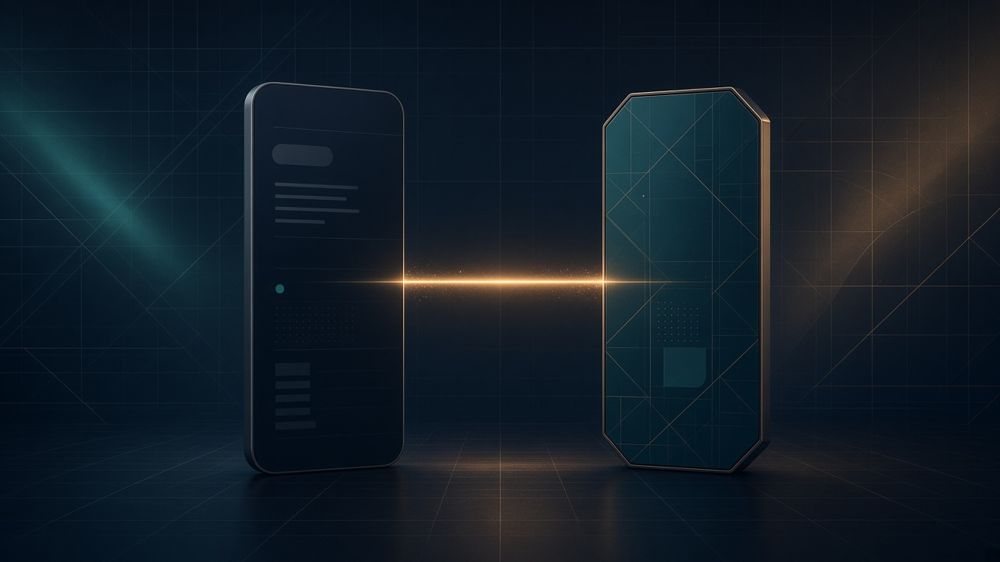
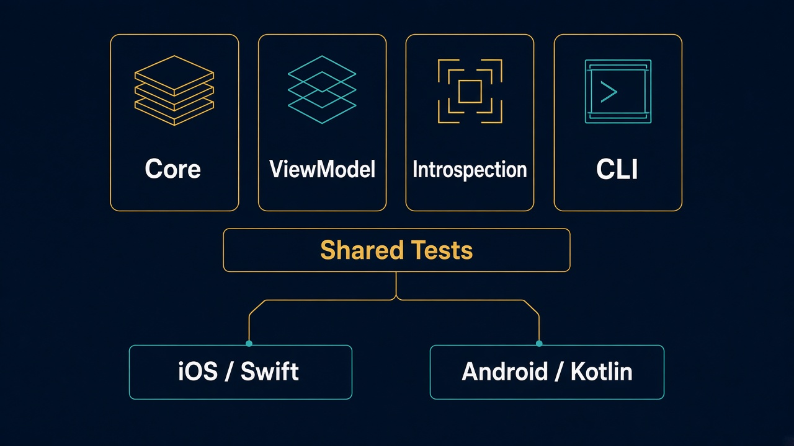
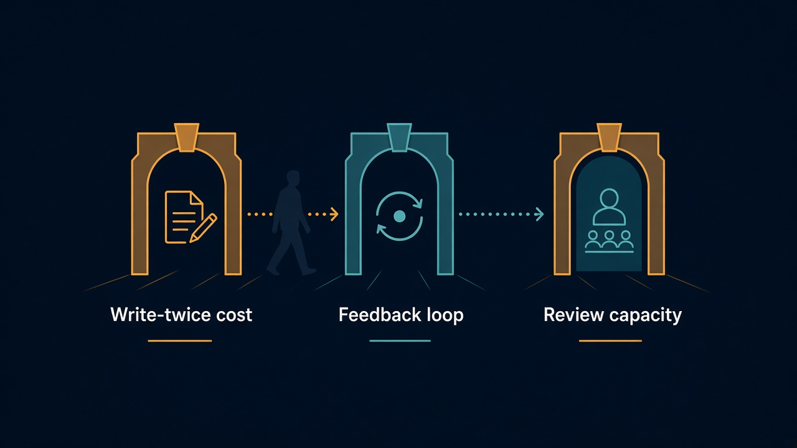

2026 年 11 月 10 日，Shopify 宣布用 **约 30 名工程师、12 周时间**，把他们最大的商户端应用 Shopify App（也称 Shopify Mobile）从运行 New Architecture 的 React Native，完整重建为原生的 Swift 与 Kotlin。用户无感切换，保持登录，偏好保留，从用户视角只是一次更新后继续能用。[How we rebuilt the Shopify app in 12 weeks](https://shopify.engineering/shopify-app-rebuild)

对技术负责人来说，真正该停下来看的不是「某个模型突然能独立写完原生 App」，而是成本公式的改写：**Agent 改变的是『写两遍 = 做两倍工作』的假设**，而『为各平台而构建』的优势还在。这件事最大的决策价值不是「跨端已死」，而是架构边界的判断条件变了——需要重新算账，而不是情绪化站队。

**核验说明：** 本文依据 Shopify 2026 年 9 月至 11 月官方工程博客整理（[back-to-native](https://shopify.engineering/back-to-native)、[Shop 迁移](https://shopify.engineering/shop-app-migration)、[Helix](https://shopify.engineering/helix)、[Reflex](https://shopify.engineering/reflex)、[重建文](https://shopify.engineering/shopify-app-rebuild)），是官方资料解读与决策建议，**不是**本团队迁移实践，也没有第一手基准测试。

*概念图：Agent 改变的是实现成本，决策仍要落在架构、反馈、审查与平台能力。*

<!--more-->

## 必须先拆清的两件事：Shop App ≠ Shopify App

这是两个应用、两次「12 周」，指标不能混用。技术讨论里很多争论来自这里没拆清。

### Shop App（买家购物 App）

2026 年 9 月 10 日，Shopify [宣布回归原生](https://shopify.engineering/back-to-native) 的同时，公布 Shop App 的迁移已经完成：在 AI 辅助下，从 proof of concept 到完整重建并上架，用了 12 周。

**Shop App 官方指标**（来源：[Shop 迁移文](https://shopify.engineering/shop-app-migration)）：

| 维度 | React Native | 原生 | 改善 |
| --- | --- | --- | --- |
| iOS 启动时间 | 3200 ms | 2466 ms | 减少 23% |
| Android 启动时间 | 4433 ms | 2233 ms | 减少 50% |
| 稳定性 | 历史约 99.5%+ | 会话稳定性 99.95%+ | 崩溃会话减少约 10 倍 |

### Shopify App / Shopify Mobile（商户端，最大的那个）

2026 年 11 月 10 日宣布：约 30 名工程师，把 Shopify App（300+ 屏幕，home & lockscreen widgets、Apple Watch app、complications、Siri Shortcuts）从运行 New Architecture 的 React Native，重建为完全原生，也用了 12 周。

**Shopify Mobile 官方指标**（来源：[重建文](https://shopify.engineering/shopify-app-rebuild)）：

| 维度 | React Native | 原生 | 改善 |
| --- | --- | --- | --- |
| Android P50 启动 | 1.71s | 0.87s | 约 50% |
| iOS P50 启动 | 0.70s | 0.60s | 约 14% |
| Android 包体 | 80.4MB | 47.6MB | 小了 40% |
| Android P50 内存 | 470MB | 200MB | 约一半 |
| iOS P50 峰值内存 | 730MB | 190MB | 降幅超 70% |
| Android crash-free sessions | 99.66% | 99.98% | 稳定性提升 |
| iOS crash-free sessions | 保持在 99.95% 目标之上 | — | — |

官方还强调：能在能力到来时直接支持平台特性，例如 iPhone Duo 当天支持；增加了 self-healing 能力，agents 可检测并自动修复崩溃（见后文）。

**这两组数字只能对号入座，不要写成「Shopify 全系」。** 讨论 Shopify Mobile 的时候引用 Shop App 的启动时间，或者反过来，都是事实分层错误。

## 成本假设如何被改写：写两遍不再等于做两倍工作

Shopify 自己写得很清楚：React Native 在 2020 年的选择是成功的；他们不是因为 RN 突然变慢或不能用才走的。[back-to-native](https://shopify.engineering/back-to-native) 原文明确说：

> React Native apps can be fast. Ours are.

变更原因是 **agents 降低了「共享实现」的优势，而「为各平台而构建」的优势还在**。

官方承认：

> Native still means building and maintaining software on two platforms, that cost has not disappeared.

**变的是 agents 能承担足够多的实现、翻译、测试和审查**，使它不再像 2020 年那样是决定性因素。

因此技术负责人不能把这篇新闻读成「跨端已死，立刻全面回原生」。这是 Shopify 在自身体量、存量 RN 参考实现、自研 Helix/Reflex/远程开发环境、以及审查能力重组之后的选择。

他们明确反对 vibe coding / 一次性让 LLM 对着 RN 仓库 one-shot 出可上架代码。[back-to-native](https://shopify.engineering/back-to-native) 说：

> 即使用规格、task files 再实现，仍会得到大量无法维护、无法上架的代码。

真正的方法是什么？

## 方法：Greenfield 重建 + 「现有应用就是更好的规格」

Shopify 选的是 **greenfield 重建**，而不是 brownfield 渐迁。理由（[官方](https://shopify.engineering/back-to-native)）：

- LLM 善于以 RN 版为参考用 Swift/Kotlin 实现
- 干净重建没有旧约束
- 原型显示能比没有 coding agents 时快得多

过去迁到 RN 时他们曾对部分大应用采用 brownfield，因为重写要数年且会打断发版。这次不同。

[重建文](https://shopify.engineering/shopify-app-rebuild) 写道：

> 先写规格再交给 agent 不成功，规格很快过时。

Helix（Shopify 自研工具）读取存量 RN 屏幕作为 **live reference**，切成可在数分钟内审查的小 checkpoint。每个 checkpoint 必须：

1. 用测试证明行为
2. 通过与参考应用的视觉对比
3. 经受两次 adversarial code review
4. 得到人的点头

才能提交并开始下一个。审查反馈会被记住。

**新功能没有旧屏可对照时怎么办？** 官方承认这是 **next challenge**。文中不要把「迁移方法论」直接推销成「日常新功能开发已经完全可复制」。

## Reflex 架构：共享测试，不共享代码

Shopify 在 [Reflex](https://shopify.engineering/reflex) 一文中给出的原则是：

> Share the test, not the code.

**代码写两遍，测试写一遍。** 没有跨端共享代码层。Swift on iOS，Kotlin on Android，各自 UI toolkit 与并发模型，中间没有 cross-platform layer。

官方判断：**在 agents 写大部分代码时，写第二份原生实现比维护一层桥更便宜。**

*Reflex 架构：Core、ViewModel、Introspection、CLI 四根支柱支撑双端共享测试，而不是共享代码。*

### Reflex 四根支柱（必须写对）

1. **无 UI 的 Core 模块**：除视图外的一切，无 UI import、无设备依赖，可在 macOS 或 JVM 无头运行。
2. **严格的 ViewModel 契约**：Elm 风格，actions in, state out，状态只在一处改变（update）。
3. **ViewModel introspection**：JSON 契约（name、state、可接受的 actions），让外部进程（CLI）读写屏幕。
4. **平台无关 CLI**：对上述契约发命令，不必启动模拟器/真机。`ls` 打印当前屏幕名、state JSON、可执行 actions；`do Action [json]` 触发一个 action。CLI 可以对无头 core 或真实构建，但只和 ViewModel 说话，从不操作渲染后的 UI。

### 模块切分

- **Core**：ViewModels、services、navigation state、GraphQL、持久化逻辑、deep links。iOS 是 plain Swift package，Android 是 plain JVM module；无 UIKit、无 android.*
- **Mobile**：SwiftUI/Compose、Keychain、push、camera、share sheet。依赖 Core，Core 不知 Mobile。
- **CLI**：同样依赖 Core，跑在 macOS 或 JVM。

Core 用构造函数注入平台能力，不用 DI 框架。Introspection Kit 是独立模块；删掉 introspection 文件应用仍能编译运行，只是失去终端驱动能力。

### 测试形态

官方称更像 **trophy**、中间层很宽。**1,700+ behavior tests 在 CI 上双端大约四分钟跑完**。无网络，强制 fixture；一次 journey 可能带十几个 GraphQL 响应。

测试 SDK 写在 Bun test runner 上，**同一测试文件跑 iOS 与 Android**。热身后无设备用例大约几百毫秒；同一测试在 iOS 模拟器大约两秒。

UI 验证另走 Helix checkpoint 的视觉审查，以及少量截图测试。

**官方没有把 Reflex 开源**；原文说 "This article is the open source."。不要写「可直接引入 Shopify Reflex 库」或捏造包名。

## 组织与工作流：两人一组，跨端拥有，Agent 夜间继续

[重建文](https://shopify.engineering/shopify-app-rebuild) 描述的组织方式：

- 约 30 人，**两人一组的 pod**，每组跨 iOS/Android 拥有一块产品区域
- 两人白天结对，每人同时 steer 多个 agent
- Agent 夜间和周末继续工作，早上面对待审 PR 队列
- 不是「一个 iOS 团队 + 一个 Android 团队」
- **一个 PR 包含双端改动**。CI 会在 iOS 与 Android 以架构不允许的方式分叉时失败

## 瓶颈如何迁移：从实现到审查、合并、协调

### Agent 是第一审

每个 PR 先对照架构指南做 **adversarial review**，再进人审。

### 人仍是最后决策者

审的是意图、架构契合、产品行为、以及是否属于数百万用户依赖的代码库。

人无法逐行审 100 倍代码；工作被切成小 checkpoint，**diff 大小是给 agent 的约束**。

每天结束，agent 把当天审查意见写回 skills 和 Architecture.md。

### 瓶颈依次是：机器、合并、协调

- **机器成为瓶颈**，所以做了 remote development environment。
- **合并成为瓶颈**：agents 负责 rebase、冲突、CI、flaky tests。
- **协调成为瓶颈**：crash 自愈循环每 15 分钟查找新崩溃；Slack agent River 在远程开发环境复现并开修复 PR。**人第一次知道崩溃，可能是 PR 来了。** 所有权按产品区域归属 pod，减少重复开工。

这不是「无人值守自动上架」，而是工程系统的**瓶颈持续迁移**。

## 给技术负责人的决策清单

不要先问「要不要学 Shopify 回原生」，而应先问下面几件事：

*决策门槛：Agent 改写的是第一项，后两项仍是系统约束。*

### 1. 你要优化的是什么？

性能/平台能力，还是「只写一份实现」的人力成本？两者被 Agent 改写的程度不同。

### 2. 有没有可作为 live spec 的存量实现？

没有参考屏时，Shopify 自己也说这是下一步难题。

### 3. 反馈闭环能不能快到匹配 Agent？

如果验证还依赖模拟器截图/无障碍树，官方的经验是迭代会慢到以分钟计。没有无头 core + 契约化 ViewModel + 可执行检查，只把模型换成更强的，解决不了这个瓶颈。

### 4. 审查容量是否被当成系统约束？

写得更快而人审跟不上，只是把等待从实现挪到集成。

### 5. 双端一致性靠什么卡住？

共享代码、共享测试、还是流程约定？Shopify 选的是「共享测试 + 同构架构 + CI 分叉即失败」，这需要你愿意牺牲一部分平台惯用写法。

### 6. 工具是自研成本还是可复用能力？

Helix、Reflex、远程开发环境都是 Shopify 内部系统；公开的是方法，不是可安装的产品。不要承诺「下周就能上同一套工具」。

### 7. 先做小范围原型，还是宣布全量迁栈？

Shopify 自己也是先用 LLM 在最大应用的核心部分做原型，再决定 greenfield。

## 不适合直接照搬的情况

- 小团队没有审查容量
- 没有可对照的存量应用
- 产品强依赖一套跨端设计系统且平台差异不是瓶颈
- 无法把业务逻辑从 UI/设备依赖中拆出

**不要贬低 Flutter / React Native / KMP**；它们仍然成立，只是成本公式变了，需要重新算，而不是情绪化站队。

## 开源库去向（背景参考）

[back-to-native](https://shopify.engineering/back-to-native) 公布了 Shopify 自己库的安排：

- **React Native Skia**：Shopify 赞助到 2026 年底，William Candillon 之后继续，将 fork 并以新名发布，原仓库完成过渡后归档。
- **FlashList**：约每周 200 万次下载；Shopify 继续修破坏兼容性的关键问题，并与若干公司讨论长期托管。
- **Restyle**：将归档，维护到 2026 年底后停止。

这些是 Shopify 自己库的安排，**不要写成「整个 RN 生态停更」**。

## 小结

Shopify 用 12 周把 Shopify App 迁回原生，展示的不是「跨端已死」，而是 **Agent 改变了成本公式的一项——『写两遍』的成本**。另外几项——反馈闭环、审查容量、平台能力差异、存量参考实现——仍然是决策的输入。

技术负责人的判断应落在：**架构是否可执行、反馈是否够快、审查是否跟得上**，而不是「要不要放弃跨端」。这是工程架构、工作流与验证体系的变化，不是某个模型突然能独立写完原生 App 并自动上架。

Shopify 公开的是方法，不是可安装的产品。复制之前，先算清自己的账。

---

**核验说明：** 本文主要依据 Shopify 官方工程博客（[back-to-native](https://shopify.engineering/back-to-native)、[Shop 迁移](https://shopify.engineering/shop-app-migration)、[Helix](https://shopify.engineering/helix)、[Reflex](https://shopify.engineering/reflex)、[重建文](https://shopify.engineering/shopify-app-rebuild)）整理；**未运行 Shopify 内部工具，未对本团队应用做实测**。发布前请以官方博客最新版为准。
