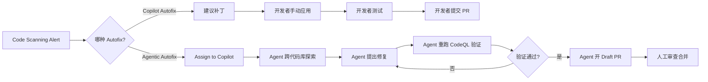

2026 年 10 月 15 日，GitHub 宣布 [Agentic Autofix for Code Scanning Alerts 正式 GA](https://github.blog/changelog/2026-10-15-agentic-autofix-for-code-scanning-alerts-general-availability/)。从这天起，如果你有 Advanced Security 许可并打开了相关策略，单条 code scanning alert 上的"Generate Fix"按钮会被"Assign to Copilot"取代——后者不再只给建议补丁，而是跨代码库探索、重跑 CodeQL 验证、必要时迭代，最终开出一个 draft PR 等你审。

这篇文章的目标读者是**技术负责人和安全团队**：需要在"建议补丁够用吗"与"要不要上端到端修复 Agent"之间做决策的人。我会区分模型能力、Agent 工作流能力、默认权限与审批模式、计费四个层次，讲清 Agentic Autofix 与免费 Copilot Autofix 的边界，并给出落地清单。

<!--more-->

## 一、建议补丁 vs 验证后开 PR：不是一回事

在 Agentic Autofix GA 之前，GitHub 已经有两种"autofix"：

1. **Copilot Autofix**（免费，默认开启）：对单条 code scanning alert 给出建议代码改动，开发者自己应用、测试、提交。
2. **Agentic Autofix**（需 Advanced Security 许可 + 策略开启）：Agent 端到端处理 1-25 条 alerts，探索代码库、重跑 CodeQL 验证、开 draft PR 供人审。

两者的本质区别在**工作流深度**：

**Copilot Autofix** 是建议，不消耗 AI Credits，适合开发者自己能快速判断和应用的场景。**Agentic Autofix** 是端到端执行，消耗 AI Credits + Actions minutes，适合安全债堆积、需要批量处理、或者修复需要跨多个文件协调的场景。

官方文档明确：启用 Agentic Autofix 后，单条 alert 上的免费 Generate Fix 按钮会被 Assign to Copilot 取代。这不是"两个功能并存"，而是**策略选择**——要么让开发者拿建议自己改，要么让 Agent 改完开 PR。

## 二、两种 Autofix 对比表

| 维度 | Copilot Autofix（免费） | Agentic Autofix（GA） |
| --- | --- | --- |
| **工作流** | 建议代码改动，开发者应用 | 端到端调查、修复、开 draft PR |
| **批量处理** | 单条 alert | 1-25 条 alerts 合成一个 PR |
| **验证手段** | 无（人工测试） | 重跑 CodeQL 验证（best-effort） |
| **是否开 PR** | 否（需人手动提交） | 是（draft PR） |
| **消耗 AI Credits** | 否 | 是（每个 agent session） |
| **消耗 Actions minutes** | 否 | 是（重跑 CodeQL） |
| **支持范围** | CodeQL code scanning alerts | 仅默认分支上的 code scanning alerts |
| **适用场景** | 单点修复、开发者能快速判断 | 安全债批量处理、跨文件协调修复 |
| **启用门槛** | 默认开启（除非管理员关闭） | Enterprise admin 开策略 + Org/Repo admin 启用 + 定义 Copilot billing method |
| **账号类型限制** | 无（EMU 可用） | EMU 名下仓库不可用；个人公开仓可由 repo admin 直接启用 |

需要特别说明的是验证边界：Agentic Autofix 会用 code scanning query suite **重跑 CodeQL**，但**不能确认**自定义 CodeQL 查询、`security-extended` suite、或第三方扫描工具（如 Snyk、Checkmarx）产生的 alerts。验证是 best-effort，官方文档始终提醒：**合并前人工 review 与测试**。

## 三、Agent 能力边界：这是工作流能力，不是模型榜分数

很多讨论会把"Agentic Autofix 比 Copilot Autofix 强"和"模型推理能力更强"混为一谈。实际上，这里的差异是 **Agent / harness 能力**，而不是模型评测榜上的分数。

### Agent 能做什么

根据官方 Changelog 和文档，Agentic Autofix 的工作流是：

1. **Assign alert 给 Copilot**：从默认分支的 alert 页面，或者 security campaign 中一次选中最多 25 条。
2. **跨代码库探索**：Agent 不仅读 alert 所在文件，还会探索相关模块、依赖、测试。
3. **提出修复 + 重跑 CodeQL**：生成修复代码，然后用 code scanning query suite 重新扫描，验证 alert 是否关闭。
4. **必要时迭代**：验证失败？调整修复，重新跑。
5. **开 draft PR**：成功后，开一个 draft PR，包含修复摘要、为何关闭 alert、验证步骤说明。

### Agent 不能做什么

- **只支持默认分支**：仅出现在 PR 或其他分支的 alert 无法 assign。
- **25 条上限**：一次性批量修复最多 25 条 alerts。
- **验证有盲区**：自定义查询、security-extended、第三方工具的 alerts 无法自动验证。
- **不会自动合并**：始终开 draft PR，需要人审查后合并。

这些限制不是"模型不够聪明"，而是**工作流设计的边界**。例如，"只支持默认分支"是策略选择（避免在临时分支上大量开 PR），"25 条上限"是资源与成本控制，"验证有盲区"是工具链约束（CodeQL 无法验证它不认识的查询）。

## 四、权限与治理：策略开关 ≠ 不能自主执行

有一个常见误解：因为 Agentic Autofix 需要 enterprise admin 先开策略，所以"它没有自主执行能力，只能生成建议"。

这是混淆了**默认权限与审批模式**和 **Agent 能力**。

### 启用路径

官方文档给出的完整启用路径是：

1. **Enterprise admin**：在 Advanced Security policies 页面开启"Agentic autofix"策略。
2. **Org/Repo admin**：在 Code Security 设置里打开。
3. **定义 Copilot billing method**：关联计费账户。

启用后，Agent **确实会自主执行**：探索代码、生成修复、重跑 CodeQL、开 PR。但它开的是 **draft PR**，需要人审查后才能合并。

### 默认治理面

- **策略层**：enterprise 可以控制哪些 org/repo 有资格启用。
- **审批层**：Agent 不会直接合并到默认分支，而是停在 draft PR。
- **透明度**：PR 包含修复摘要、验证步骤、关闭了哪些 alerts。

这套设计是"默认要审批"，但不是"不能自主执行"。区分这两者很重要：前者是治理策略（企业合规要求、防止未经审查的代码进主干），后者是能力边界（Agent 能否完成一整条流水线）。

对比：免费的 Copilot Autofix **真的不能自主执行**——它只给建议，开发者拿到建议后，应用、测试、提交、开 PR 全是人工。Agentic Autofix 把后面这些环节自动化了，只是最终合并仍然需要人来按。

## 五、计费：只复述官方已公布的

GitHub 官方文档公布的计费信息：

- **消耗内容**：每个 agent session 消耗 **AI Credits**（Code Security 的 budget）+ **GitHub Actions minutes**（重跑 CodeQL）。
- **记录位置**：企业账单里的 **AI usage** 部分，记为 **Advanced Security** 产品。
- **预算控制**：可以设 SKU 级预算。

官方 **没有公布** 具体单价、每个 session 消耗多少 credits、或者免费额度。因此，本文不编造数字。

### 建议做法

1. **试点时设预算**：在 enterprise billing 里为 Advanced Security 的 AI Credits 设上限，防止超支。
2. **监控用量**：启用初期，在账单里跟踪实际消耗，评估是否值得推广。
3. **不要用过时叙述**：不要把 Cursor 的 fast/slow requests、Windsurf 的按量说法混进来——这是 GitHub 自己的 AI Credits 体系。

## 六、落地清单（技术负责人视角）

如果你正在评估是否启用 Agentic Autofix，这里是完整的决策清单：

### 1. 前置条件检查

- [ ] 有 **GitHub Enterprise Cloud** 账号（含 data residency）
- [ ] 有 **GitHub Code Security / Advanced Security** 许可
- [ ] 已启用 **code scanning**（CodeQL 或第三方工具）
- [ ] 已定义 **Copilot billing method**

### 2. 适用场景判断

适合上 Agentic Autofix 的场景：
- **安全债堆积**：默认分支上有几十上百条未修复的 code scanning alerts。
- **跨文件协调修复**：修复需要同时改多个模块，Copilot Autofix 的单点建议不够。
- **批量处理需求**：想一次性处理一类 alerts（如 SQL 注入、XSS），而不是逐条手动改。

不适合的场景：
- **自定义查询为主**：alerts 多数来自自定义 CodeQL 或第三方工具，Agent 无法验证。
- **非默认分支的修复**：只在 PR 或特性分支上出现的 alerts。
- **开发者能快速判断**：单点、明显的修复，Copilot Autofix 的建议就够用。

### 3. 试点策略

- **选择试点仓库**：挑 1-2 个有明确 CodeQL alerts、非核心业务的仓库。
- **开启策略**：enterprise admin 在 Advanced Security policies 开启；org/repo admin 启用。
- **批量 assign**：从 security campaign 或 alert 列表选中 5-10 条，assign 给 Copilot。
- **观察 PR 质量**：Agent 开的 draft PR 是否真的修复了 alerts？有没有引入新问题？
- **跟踪用量**：在 enterprise billing → AI usage 里看实际消耗。

### 4. 与现有流程并存

- **Copilot Autofix 会被取代**：启用后，单条 alert 上的免费 Generate Fix 按钮消失。
- **security-extended 和第三方工具的 alerts 仍要人肉**：Agent 验证不了，只能开发者手动处理。
- **PR review 标准**：制定 Agentic Autofix 开的 PR 的审查标准（如必须通过全量测试、必须人工回归验证）。
- **定时批量处理**：可以每周或每月跑一次 security campaign，批量 assign alerts 给 Copilot。

### 5. 回退方案

如果试点效果不理想（用量高、PR 质量低、团队不适应）：
- Org/repo admin 可以在设置里关闭 Agentic autofix。
- 关闭后，单条 alert 上会恢复免费的 Generate Fix 按钮。

## 七、结论：什么时候上，什么时候不上

### 上 Agentic Autofix 的时机

- 默认分支上有**大量未修复的 CodeQL alerts**，手动清理成本高。
- 修复常常需要**跨多个文件协调**，单点建议不够。
- 团队有**明确的 PR review 流程**，能消化 Agent 开的 draft PR。
- 愿意为 **AI Credits + Actions minutes** 付费，换安全债清理效率。

### 继续用 Copilot Autofix（建议补丁）的时机

- Alerts 多数是**单点、明显的修复**，开发者能快速判断。
- Alerts 主要来自**自定义查询、security-extended 或第三方工具**，Agent 验证不了。
- 需要修复的 alerts 出现在**非默认分支**（Agentic Autofix 不支持）。
- 当前没有 Advanced Security 许可，或者不想消耗 AI Credits。

### 混合策略

很多团队最终会采用**混合策略**：

- 对 CodeQL 标准 query suite 产生的 alerts，用 Agentic Autofix 批量处理。
- 对自定义查询、security-extended、第三方工具的 alerts，保持人工 + Copilot Autofix 建议。
- 定期（如每月）跑一次 security campaign，批量 assign 积压的 alerts 给 Copilot。

## 八、参考资料

本文所有事实来自 GitHub 官方文档和 Changelog，以官方最新页面为准：

- [Agentic Autofix for Code Scanning Alerts - General Availability (Changelog, 2026-10-15)](https://github.blog/changelog/2026-10-15-agentic-autofix-for-code-scanning-alerts-general-availability/)
- [Autofix for Code Scanning - Concepts (官方文档)](https://docs.github.com/en/code-security/concepts/code-scanning/autofix-for-code-scanning)
- [GitHub Advanced Security 计费文档](https://docs.github.com/en/billing/managing-billing-for-your-products/managing-billing-for-github-advanced-security)

技术选型的本质是权衡。Agentic Autofix 提供的是**端到端修复 + 验证 + 开 PR** 的工作流自动化，而不是"更聪明的模型"。它适合安全债清理和批量处理，但默认分支、25 条上限、验证盲区、draft PR 审批、AI Credits 消耗都是需要纳入决策的真实约束。

希望这篇文章能帮你理清 Agentic Autofix 与免费 Copilot Autofix 的边界，做出适合自己团队的选择。
